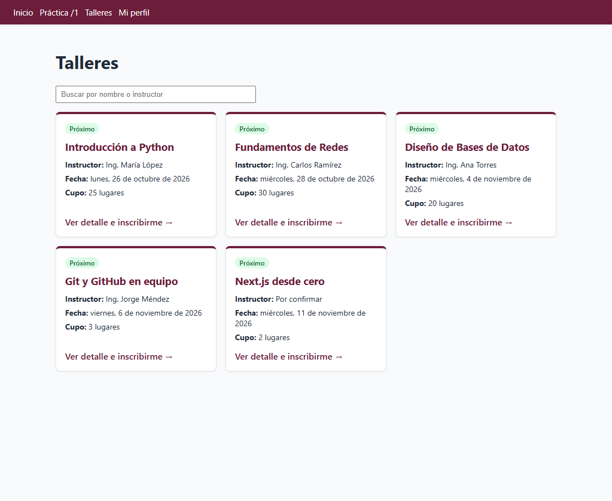
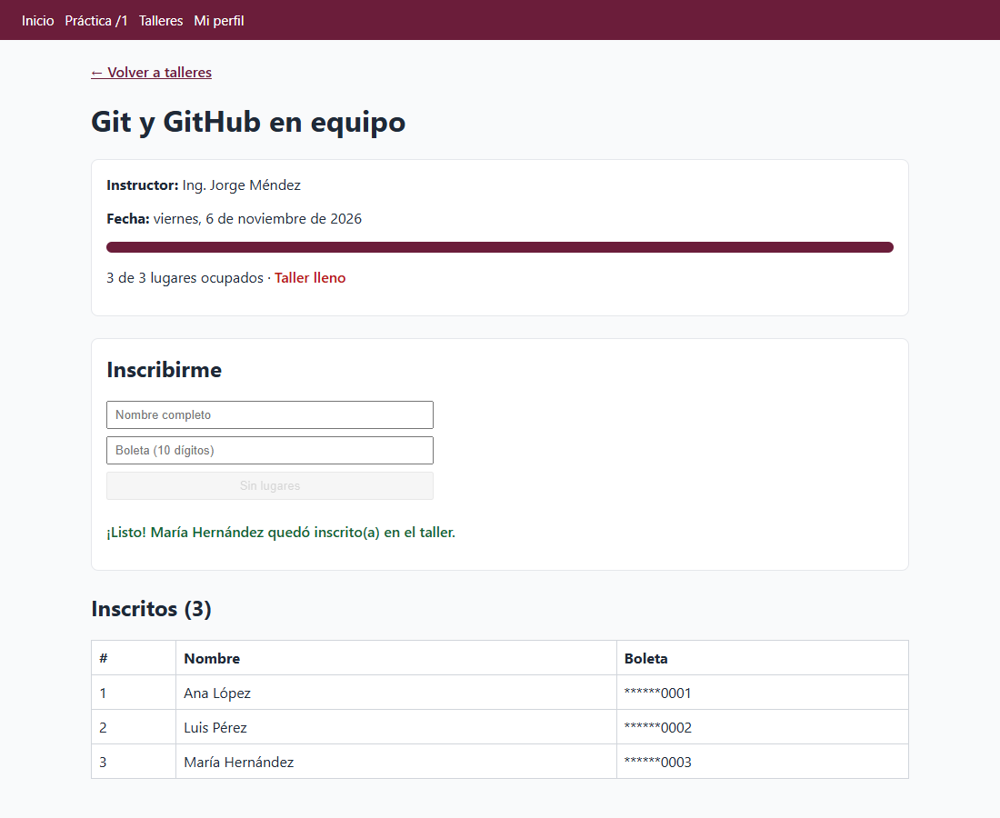
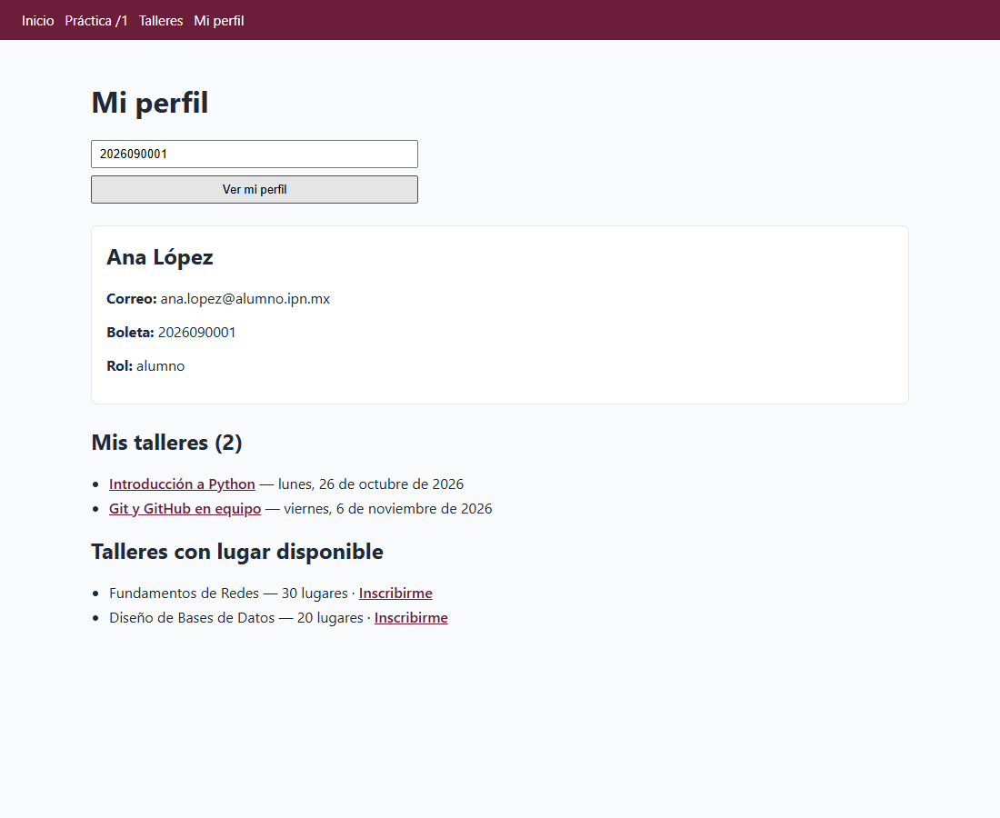

# Semana 9 — Actividad autónoma: el front consume el backend

**Programación Web · 19 al 23 de octubre · trabajo individual**

Esta semana tu docente no estará en el salón. Vas a trabajar solo con esta guía. Al terminar, tu
mini-proyecto Next.js (el mismo de la semana 6) tendrá tres páginas nuevas que **consumen el backend**:

| Página | Qué muestra | Qué le pide al backend |
|---|---|---|
| `/talleres` | Todos los talleres en tarjetas, con buscador | `GET /api/talleres` |
| `/talleres/[id]` | Detalle de un taller, lugares ocupados, inscritos y formulario para inscribirte | `GET /api/talleres/:id`, `GET /api/talleres/:id/asistencias`, `POST /api/asistencias` |
| `/perfil` | Tus datos (buscados por boleta), tus talleres y los que tienen lugar | `GET /api/usuarios`, `GET /api/talleres` y las asistencias de cada taller |

Así se verá **al terminar el paso 7**:



## Lo que vas a aprender

Esta actividad es la **Vista** del modelo MVC que viste en la semana 7 y usa los métodos **GET** y **POST**
contra un backend con datos (Unidad 2, AE2; Práctica 4 "Desarrollo de páginas dinámicas con BD").
Al terminar sabrás:

1. Pedir datos a un backend con `fetch` desde una página de React y mostrar los estados *cargando*, *error* y *vacío*.
2. Manejar los errores HTTP (como el 404 de un registro que no existe o el 500 de un backend caído) sin que la página truene.
3. Separar la vista en **componentes** que reciben *props* y darles estilo con **CSS Modules**.
4. Leer un parámetro de la URL en una **ruta dinámica** para pedir un solo registro.
5. Mandar datos con **POST** desde un formulario, validarlos antes de enviarlos y actualizar la vista con la respuesta.
6. Entender cómo combinar varias peticiones con `Promise.all` cuando el backend no tiene la ruta exacta que necesitas (lo ves en el paso 6 y lo escribes tú en el reto extra 2).

## Cómo organizar tu tiempo

La materia tiene 3 horas a la semana. Organízalas así:

| Cuándo | Pasos | Tiempo aproximado |
|---|---|---|
| Clase 1 (1 h, aula) | 0, 1 y 2 | 60 min |
| Clase 2 (2 h, laboratorio) | 3, 4 y 5 | 120 min |
| Fuera de clase, antes de la siguiente sesión | 6, 7 y 8 (incluye el reporte) | 120 min |

Si vas adelantado, sigue con el siguiente paso. Si te atrasas, **no te saltes pasos**: cada uno usa lo del anterior.

**Cómo usar esta guía**

- Escribe el código tú mismo (no lo copies y pegues sin leerlo): cada bloque trae una explicación de qué hace.
- Donde diga **Tu turno**, la guía no te da el código completo: lo escribes tú con la pista.
- Al final de cada paso hay una lista **Comprueba**. No pases al siguiente hasta que todo esté marcado.
- Si algo falla, revisa primero la sección [Problemas comunes](#problemas-comunes).

---

## Paso 0 — Preparar el material (15 min)

En esta carpeta (`semana-09/actividad-autonoma-front/`) hay dos cosas:

- `backend-memoria/`: un backend **ya hecho**, con las mismas rutas que el backend del proyecto, pero que
  guarda los datos en memoria. No necesita MySQL ni `.env`: esta semana te concentras solo en el front.
  **No lo modifiques.** Cada vez que lo reinicias, los datos vuelven a los de ejemplo.
- `base/mini-proyecto-next/`: los archivos nuevos para tu app.

1. **Copia los archivos nuevos encima de tu app**: la carpeta donde trabajaste el mini-proyecto en la
   semana 6 (en esta guía la llamamos `mini-proyecto-next`, pero la tuya puede llamarse distinto). Copia el
   **contenido** de `base/mini-proyecto-next/` y acepta reemplazar `components/Menu.js`.
   Tu `pages/index.js` y tu `pages/practica/[id].js` no se tocan.
   En Windows: abre `base/mini-proyecto-next/`, selecciona **todo lo que hay dentro** (Ctrl+A), cópialo y
   pégalo dentro de tu carpeta del mini-proyecto. Si al final tienes una carpeta `mini-proyecto-next` dentro
   de otra, copiaste la carpeta en lugar de su contenido.

   | Archivo | ¿Quién lo escribe? |
   |---|---|
   | `components/Menu.js` | Ya viene hecho (agrega Talleres y Mi perfil al menú) |
   | `lib/formato.js` | Ya viene hecho (fechas en español y boleta oculta) |
   | `lib/api.js` | **Tú**, paso 1 |
   | `pages/talleres/index.js` | **Tú**, pasos 2, 3 y 7 |
   | `components/TarjetaTaller.js` y `TarjetaTaller.module.css` | **Tú**, pasos 3 y 7 |
   | `pages/talleres/[id].js` | **Tú**, pasos 4, 5 y 6 |
   | `pages/perfil.js` | **Tú**, paso 6 |
   | `styles/Talleres.module.css` | **Tú**, pasos 3 a 7 |

2. **Arranca el backend** en una terminal:

   ```bash
   cd backend-memoria
   npm install
   npm start
   ```

   Debe decir `Servidor escuchando en el puerto 3001 (BD: memoria; ...)`. **Deja esa terminal abierta.**

3. **Prueba el backend en el navegador** (antes de programar nada, asegúrate de que responde):

   - http://localhost:3001/api/talleres → arreglo con 5 talleres
   - http://localhost:3001/api/talleres/a1000000-0000-4000-8000-000000000004 → "Git y GitHub en equipo", con `"asistentes": 2`
   - http://localhost:3001/api/talleres/a1000000-0000-4000-8000-000000000004/asistencias → sus 2 inscritos
   - http://localhost:3001/api/usuarios → 4 usuarios (el admin, Ana, Luis y María)

4. **Arranca tu app** en **otra** terminal, dentro de tu carpeta del mini-proyecto:

   ```bash
   npm install
   npm run dev
   ```

   Abre http://localhost:3000. En el menú ya aparecen **Talleres** y **Mi perfil** (todavía no muestran nada).

**Datos de ejemplo para tus pruebas**

| Boleta | Nombre | Notas |
|---|---|---|
| `2026090001` | Ana López | Inscrita en Python y en Git |
| `2026090002` | Luis Pérez | Inscrito en Git y en Next.js |
| `2026090003` | María Hernández | Inscrita en Next.js |
| `2026999999` | Alumno sin cuenta | Inscrito en Python, pero no es usuario |
| `0000000000` | Admin Semilla | Usuario con rol `admin`, sin talleres |

"Git y GitHub en equipo" tiene cupo 3 (le queda 1 lugar), "Next.js desde cero" tiene cupo 2 (está lleno) y
"Fundamentos de Redes" y "Diseño de Bases de Datos" todavía no tienen inscritos.

**Comprueba**

- [ ] El backend responde en http://localhost:3001/api/talleres
- [ ] Tu app abre en http://localhost:3000 y el menú tiene Talleres y Mi perfil

---

## Paso 1 — Una sola función para hablar con el backend (15 min)

Tus páginas van a hacer muchas peticiones. En vez de repetir en cada una el `fetch`, la revisión de
errores y el `res.json()`, todo eso vive en **una sola función**: `pedirJSON`, en `lib/api.js`.

**¿Por qué `/api/talleres` y no `http://localhost:3001/api/talleres`?** El navegador solo habla con Next
(puerto 3000). `next.config.js` (viene en tu kit desde la semana 6) tiene un *proxy*: todo lo que empieza
con `/api/` lo reenvía a `http://localhost:3001`. Así no hay problemas de CORS.

Abre `lib/api.js` y reemplaza **toda** la función `pedirJSON` (la que tiene el `TODO paso 1`; deja las 2
constantes de arriba) por esta:

```js
export async function pedirJSON(ruta, opciones = {}) {
  let res;
  try {
    res = await fetch(`${API_URL}/api${ruta}`, {
      ...opciones,
      headers: { 'Content-Type': 'application/json', ...opciones.headers },
    });
  } catch {
    // Sin proxy (NEXT_PUBLIC_API_URL) y con el backend apagado, fetch falla antes de recibir respuesta.
    throw new Error(BACKEND_CAIDO);
  }

  // Un 204 no trae cuerpo, y con el backend apagado el proxy de Next responde 500 en texto, no en JSON.
  let datos = null;
  try {
    datos = await res.json();
  } catch {
    datos = null;
  }

  if (!res.ok) {
    if (datos && datos.error) throw new Error(datos.error);
    throw new Error(res.status === 500 ? BACKEND_CAIDO : `El backend respondió ${res.status}`);
  }
  return datos;
}
```

Léela con calma:

- `...opciones` (*spread*) copia dentro del objeto todo lo que mande quien llama: `method`, `body`, etc. Lo
  usarás en el paso 5 para el `POST`. En `headers` se hace lo mismo: siempre va `Content-Type` y, si quien
  llama manda más encabezados, se agregan.
- `res.ok` es `true` con los códigos 200-299. Si el backend responde 400, 404 o 500, **fetch no falla
  solo**: por eso se revisa `res.ok` y se **lanza** (`throw`) un `Error` con el mensaje que mandó el backend
  (`{ "error": "Taller no encontrado" }`).
- Quien llame a `pedirJSON` lo hará dentro de un `try/catch` y mostrará el mensaje en pantalla.

**Comprueba**

- [ ] `lib/api.js` ya no tiene el `throw new Error('pedirJSON todavía no está escrita...')`
- [ ] Abre http://localhost:3000/api/talleres (puerto **3000**): ves el mismo JSON que en el 3001. Ese es el proxy funcionando

`pedirJSON` todavía no la usa ninguna página: si tiene un error de escritura, Next te lo marcará en el paso 2.
Si la terminal de Next muestra `DeprecationWarning: The util._extend API is deprecated`, ignóralo: es un aviso
interno de Next con tu versión de Node, no de tu código.

---

## Paso 2 — `/talleres`: tu primera lista desde el backend (30 min)

Abre `pages/talleres/index.js`. Ya trae los 3 estados que necesita una página que pide datos:

| Estado | Para qué |
|---|---|
| `talleres` | El arreglo que manda el backend (empieza vacío) |
| `cargando` | `true` mientras llega la respuesta, para mostrar "Cargando…" |
| `error` | El mensaje si algo falló |

**2.1 Pedir los datos al abrir la página.** Reemplaza el comentario `// TODO paso 2: useEffect...` **y** la
función `cargarTalleres` vacía (completa, desde `async function` hasta su `}`) por:

```js
  useEffect(() => {
    cargarTalleres();
  }, []);

  async function cargarTalleres() {
    try {
      setTalleres(await pedirJSON('/talleres'));
    } catch (err) {
      setError(err.message);
    } finally {
      setCargando(false);
    }
  }
```

El `[]` al final del `useEffect` significa "solo una vez, cuando se abre la página". `finally` se ejecuta
haya salido bien o mal: en los dos casos ya no estamos cargando.

**2.2 Mostrar los datos.** Reemplaza el comentario `{/* TODO paso 2 ... */}` del `return`:

```jsx
      {cargando && <p>Cargando talleres…</p>}
      {error && <p className="error">{error}</p>}

      <ul>
        {talleres.map((t) => (
          <li key={t.id}>
            {t.nombre} — {t.fecha} — cupo {t.cupo}
          </li>
        ))}
      </ul>
```

`map` convierte cada taller en un `<li>`. React pide una `key` única en cada elemento de una lista: el `id`
del taller.

**Tu turno:** si el backend responde un arreglo vacío, la página no dice nada. Agrega un párrafo
"No hay talleres registrados." que solo aparezca cuando **ya no** se está cargando, **no** hay error y el
arreglo tiene 0 elementos. *Pista:* combina las tres condiciones con `&&`, igual que las dos líneas de arriba.

**Comprueba**

- [ ] http://localhost:3000/talleres lista los 5 talleres
- [ ] Tu mensaje de "No hay talleres registrados.": cambia **temporalmente** `setTalleres(await pedirJSON('/talleres'))` por `setTalleres([])`, revisa que aparezca y **regrésalo como estaba**
- [ ] Apaga el backend (Ctrl+C en su terminal) y recarga: aparece en rojo "El backend no responde..." en vez de que la página truene. (Es normal que **la terminal de Next** se llene de errores `ECONNREFUSED` y que la consola del navegador muestre `Failed to load resource: 500`: es el proxy avisando que no encontró el backend.) Vuelve a arrancarlo con `npm start`
- [ ] Abre las herramientas del navegador (F12) → pestaña **Red / Network**, recarga y encuentra la petición `talleres` con estado 200

> **¿Por qué aparecen dos peticiones `talleres`?** En modo desarrollo (`npm run dev`) React ejecuta cada
> `useEffect` **dos veces** a propósito (`reactStrictMode` en `next.config.js`), para ayudarte a encontrar
> errores. La segunda puede salir con estado **304** ("no cambió, usa la copia que ya tienes"). No es un error
> de tu código, y en producción la petición sale una sola vez.

---

## Paso 3 — Mejorar la vista: tarjetas con un componente (35 min)

Una lista `<ul>` funciona, pero se ve pobre. Vas a crear un **componente** `TarjetaTaller` que reciba un
taller por *props* y lo dibuje como tarjeta. Los estilos van en un **CSS Module**: un archivo
`.module.css` cuyas clases solo existen en el componente que lo importa (Next les cambia el nombre para
que no choquen con otras).

**3.1 El componente.** Abre `components/TarjetaTaller.js` y reemplaza la función completa por:

```jsx
export default function TarjetaTaller({ taller }) {
  const pasado = yaPaso(taller.fecha);

  return (
    <article className={estilos.tarjeta}>
      <span className={pasado ? estilos.etiquetaPasado : estilos.etiqueta}>{pasado ? 'Ya pasó' : 'Próximo'}</span>
      <h3 className={estilos.titulo}>{taller.nombre}</h3>
      <p className={estilos.dato}>
        <strong>Instructor:</strong> {taller.instructor || 'Por confirmar'}
      </p>
      {/* Tu turno: fecha y cupo */}
      <Link className={estilos.enlace} href={`/talleres/${taller.id}`}>
        Ver detalle e inscribirme →
      </Link>
    </article>
  );
}
```

- `{ taller }` en los paréntesis es *desestructurar* las props: quien use el componente escribirá
  `<TarjetaTaller taller={t} />`.
- `taller.instructor || 'Por confirmar'`: un taller puede no tener instructor (`null`).
- `yaPaso` y `formatearFecha` vienen en `lib/formato.js`. **Léelo**: explica por qué
  `new Date('2026-10-26')` mostraría en México el 25 de octubre.

**Tu turno:** donde dice `{/* Tu turno: fecha y cupo */}`, agrega dos párrafos con la misma forma que el de
Instructor: **Fecha:** usando `formatearFecha(taller.fecha)` y **Cupo:** `{taller.cupo} lugares`.

**3.2 Los estilos de la tarjeta.** Escribe en `components/TarjetaTaller.module.css` (debajo del comentario que ya trae):

```css
.tarjeta {
  display: flex;
  flex-direction: column;
  gap: 6px;
  padding: 16px;
  border: 1px solid #e5e7eb;
  border-top: 4px solid #6b1d3a;
  border-radius: 8px;
  background: #fff;
  box-shadow: 0 1px 3px rgba(0, 0, 0, 0.08);
}

.titulo {
  margin: 4px 0;
  color: #6b1d3a;
}

.dato {
  margin: 0;
  font-size: 14px;
}

.etiqueta,
.etiquetaPasado {
  align-self: flex-start;
  padding: 2px 8px;
  border-radius: 999px;
  font-size: 12px;
  font-weight: 600;
}

.etiqueta {
  background: #dcfce7;
  color: #166534;
}

.etiquetaPasado {
  background: #e5e7eb;
  color: #4b5563;
}

.enlace {
  margin-top: auto;
  padding-top: 8px;
  color: #6b1d3a;
  font-weight: 600;
  text-decoration: none;
}
```

`margin-top: auto` en el enlace lo empuja al fondo de la tarjeta, aunque unas tarjetas tengan más texto que otras.

**3.3 La rejilla.** Escribe en `styles/Talleres.module.css` (debajo del comentario que ya trae):

```css
.rejilla {
  display: grid;
  grid-template-columns: repeat(auto-fill, minmax(240px, 1fr));
  gap: 16px;
}
```

`auto-fill` + `minmax(240px, 1fr)` hace que quepan tantas columnas como se pueda (3 en la computadora,
1 en el celular) sin escribir *media queries*.

**3.4 Usar el componente en la página.** En `pages/talleres/index.js`, agrega estos 2 imports arriba, junto a
los que ya hay:

```js
import TarjetaTaller from '../../components/TarjetaTaller';
import estilos from '../../styles/Talleres.module.css';
```

y cambia todo el `<ul>...</ul>` por:

```jsx
      <div className={estilos.rejilla}>
        {talleres.map((t) => (
          <TarjetaTaller key={t.id} taller={t} />
        ))}
      </div>
```

**Comprueba**

- [ ] Los talleres se ven como tarjetas en 3 columnas; al hacer la ventana angosta quedan en 1
- [ ] "Next.js desde cero" dice **Instructor: Por confirmar**
- [ ] La fecha de "Introducción a Python" dice **lunes, 26 de octubre de 2026** (no el 25)
- [ ] El enlace "Ver detalle e inscribirme →" lleva a `/talleres/<id>`, que por ahora solo dice "Detalle del taller ..." (lo completas en el paso 4)

---

## Paso 4 — `/talleres/[id]`: detalle de un taller (45 min)

Es una **ruta dinámica**, como `pages/practica/[id].js` de la semana 6: el `id` viene de la URL y se lee
con `router.query`. Esta vez lo usas para pedirle al backend **ese** taller.

Abre `pages/talleres/[id].js`. Los comentarios `TODO paso 4.1`, `4.2`, `5.1` y `5.2` marcan dónde va cada parte.

**4.1 Cargar el taller y sus inscritos.** Reemplaza el comentario `// TODO paso 4.1: useEffect...` **y** la
función `cargar` vacía (completa) por:

```js
  useEffect(() => {
    // En el primer render router.query todavía viene vacío: hay que esperar a router.isReady.
    if (!router.isReady) return;
    cargar();
  }, [router.isReady, id]);

  async function cargar() {
    try {
      setTaller(await pedirJSON(`/talleres/${id}`));
      setAsistencias(await pedirJSON(`/talleres/${id}/asistencias`));
      setErrorCarga('');
    } catch (err) {
      setErrorCarga(err.message);
    }
  }
```

**Ojo con `router.isReady`:** en el primer render Next todavía no leyó la URL y `id` es `undefined`. Sin esa
línea pedirías `/api/talleres/undefined` y el backend respondería 404.

**4.2 Calcular los lugares.** Reemplaza el comentario `// TODO paso 4.2` por:

```js
  // Lugares: se calculan con lo que ya está en el estado (cada vez que cambia, React vuelve a calcular).
  const ocupados = asistencias.length;
  const libres = taller ? Math.max(0, taller.cupo - ocupados) : 0;
  const lleno = taller !== null && libres === 0;
```

No son estados: se calculan con `asistencias` y `taller`, y se actualizan solos cuando estos cambian.

**4.3 Mostrar el detalle.** Cambia todo el `return (...)` del final por estos tres `return`:

```jsx
  if (errorCarga) {
    return (
      <main>
        <p className="error">{errorCarga}</p>
        <Link className={estilos.volver} href="/talleres">← Volver a talleres</Link>
      </main>
    );
  }
  if (!taller) return <main><p>Cargando taller…</p></main>;

  const porcentaje = Math.min(100, (ocupados / taller.cupo) * 100);

  return (
    <main>
      <Link className={estilos.volver} href="/talleres">← Volver a talleres</Link>
      <h1>{taller.nombre}</h1>

      <section className={estilos.panel}>
        <p><strong>Instructor:</strong> {taller.instructor || 'Por confirmar'}</p>
        <p><strong>Fecha:</strong> {formatearFecha(taller.fecha)}</p>
        <div className={estilos.barra}>
          <div className={estilos.relleno} style={{ width: `${porcentaje}%` }} />
        </div>
        <p>
          {ocupados} de {taller.cupo} lugares ocupados ·{' '}
          {lleno ? (
            <span className={estilos.lleno}>Taller lleno</span>
          ) : (
            `${libres} ${libres === 1 ? 'lugar libre' : 'lugares libres'}`
          )}
        </p>
      </section>

      {/* Aquí irá el formulario del paso 5 */}

      <h2>Inscritos ({ocupados})</h2>
      {/* Tu turno: tabla de inscritos */}
    </main>
  );
```

- Mientras `taller` sea `null` se muestra "Cargando…": así nunca se lee `taller.cupo` de algo que no ha llegado.
- La barra es un `div` gris con otro `div` adentro cuyo ancho es el porcentaje ocupado (`style` en línea,
  porque el valor cambia con los datos).
- `condición ? A : B` (*operador ternario*) muestra A o B. Aquí también se usa para escribir "1 lugar libre"
  pero "2 lugares libres".

Agrega a `styles/Talleres.module.css`:

```css
.panel {
  margin-bottom: 24px;
  padding: 16px;
  border: 1px solid #e5e7eb;
  border-radius: 8px;
  background: #fff;
}

.panel > :first-child {
  margin-top: 0;
}

.barra {
  height: 12px;
  overflow: hidden;
  border-radius: 999px;
  background: #e5e7eb;
}

.relleno {
  height: 100%;
  background: #6b1d3a;
}

.lleno {
  color: #b91c1c;
  font-weight: 600;
}

.volver {
  color: #6b1d3a;
  font-weight: 600;
}
```

**Tu turno:** donde dice `{/* Tu turno: tabla de inscritos */}`, elige con un ternario entre dos opciones:

- Si `ocupados === 0`: un párrafo "Todavía no hay inscritos. ¡Sé el primero!".
- Si no: la tabla. Usa este esqueleto y completa lo que falta:

  ```jsx
  <table>
    <thead>
      <tr>
        <th>#</th>
        <th>Nombre</th>
        <th>Boleta</th>
      </tr>
    </thead>
    <tbody>
      {/* una fila <tr key={a.id}> por cada asistencia, con 3 celdas <td> */}
    </tbody>
  </table>
  ```

- *Pistas:* `asistencias.map((a, i) => ...)`; el número de fila es `i + 1`; cada asistencia trae
  `nombre_alumno` y `boleta`. La boleta es un dato personal: muéstrala con `ocultarBoleta(a.boleta)`
  (se ve `******0001`).
- No quites `<thead>` ni `<tbody>`: un `<tr>` directo dentro de `<table>` es HTML inválido y React lo marca
  en la consola (`validateDOMNesting`).

**Comprueba**

- [ ] Desde la tarjeta de "Git y GitHub en equipo" llegas a su detalle: **2 de 3 lugares ocupados · 1 lugar libre** y la barra a 2/3
- [ ] "Next.js desde cero" dice **Taller lleno** en rojo y la barra está completa
- [ ] La tabla muestra los inscritos con la boleta oculta
- [ ] "Fundamentos de Redes" dice "Todavía no hay inscritos. ¡Sé el primero!"
- [ ] http://localhost:3000/talleres/no-existe muestra "Taller no encontrado" y el enlace para volver

---

## Paso 5 — Inscribirse en un taller (40 min)

Ahora el front **manda** datos: `POST /api/asistencias` con `{ taller_id, nombre_alumno, boleta }`.

**Importante:** el backend de esta semana (igual que el del proyecto) **no revisa** si el taller ya está
lleno ni si la boleta ya está inscrita. Esta semana eso lo cuida el front. (En Pruebas de Software verás por
qué no basta con revisarlo solo en el front.)

**5.1 Estados del formulario.** Reemplaza el comentario `// TODO paso 5.1` (está abajo de los 3 estados que ya hay) por:

```js
  const [nombre, setNombre] = useState('');
  const [boleta, setBoleta] = useState('');
  const [errorForm, setErrorForm] = useState('');
  const [exito, setExito] = useState('');
  const [enviando, setEnviando] = useState(false);
```

**5.2 La función `inscribir`.** Reemplaza el comentario `// TODO paso 5.2` (está abajo del cálculo de lugares
del paso 4.2, porque necesita `lleno`) por:

```js
  async function inscribir(e) {
    e.preventDefault();
    setErrorForm('');
    setExito('');

    // El backend de esta semana no revisa cupo ni inscripciones repetidas: lo cuida el front.
    const nombreLimpio = nombre.trim();
    const boletaLimpia = boleta.trim();
    if (!nombreLimpio) return setErrorForm('Escribe tu nombre.');
    if (!validarBoleta(boletaLimpia)) return setErrorForm('La boleta debe tener 10 dígitos.');
    // Tu turno: boleta repetida
    if (lleno) return setErrorForm('El taller ya no tiene lugares.');

    setEnviando(true);
    try {
      await pedirJSON('/asistencias', {
        method: 'POST',
        body: JSON.stringify({ taller_id: id, nombre_alumno: nombreLimpio, boleta: boletaLimpia }),
      });
      setExito(`¡Listo! ${nombreLimpio} quedó inscrito(a) en el taller.`);
      setNombre('');
      setBoleta('');
      await cargar();
    } catch (err) {
      setErrorForm(err.message);
    } finally {
      setEnviando(false);
    }
  }
```

- `e` es el **evento** del formulario; `e.preventDefault()` evita que el formulario recargue la página. (Por
  eso el error del `catch` se llama `err`: para no confundirlo con `e`.)
- `validarBoleta` viene de `lib/validaciones.js` (las mismas reglas que valida el backend).
- `JSON.stringify` convierte el objeto en texto JSON, que es lo que viaja en el `body` de la petición.
- Después del `POST` se llama otra vez a `cargar()`: así la barra y la tabla muestran al nuevo inscrito.
- `enviando` deshabilita el botón mientras llega la respuesta, para que un doble clic no inscriba dos veces.

**Tu turno:** donde dice `// Tu turno: boleta repetida`, si alguna asistencia del taller ya tiene esa boleta,
muestra el error "Esa boleta ya está inscrita en este taller." y no sigas (con `return`, igual que las
validaciones de arriba). *Pista:* `asistencias.some((a) => ...)` regresa `true` si al menos un elemento
cumple la condición.

**5.3 El formulario.** Cambia `{/* Aquí irá el formulario del paso 5 */}` por:

```jsx
      <section className={estilos.panel}>
        <h2>Inscribirme</h2>
        <form onSubmit={inscribir} className="formulario">
          <input placeholder="Nombre completo" value={nombre} onChange={(e) => setNombre(e.target.value)} />
          <input placeholder="Boleta (10 dígitos)" value={boleta} onChange={(e) => setBoleta(e.target.value)} />
          <button type="submit" disabled={lleno || enviando}>
            {lleno ? 'Sin lugares' : enviando ? 'Inscribiendo…' : 'Inscribirme'}
          </button>
        </form>
        {errorForm && <p className="error">{errorForm}</p>}
        {exito && <p className={estilos.exito}>{exito}</p>}
      </section>
```

y agrega a `styles/Talleres.module.css`:

```css
.exito {
  color: #166534;
  font-weight: 600;
}
```

Así debe verse "Git y GitHub en equipo" después de inscribir a María:



**Comprueba** (en "Git y GitHub en equipo")

- [ ] Un nombre cualquiera y boleta `123` → "La boleta debe tener 10 dígitos." y no se manda nada (en la pestaña Red no aparece ningún POST)
- [ ] Boleta `2026090001` (Ana ya está inscrita) → "Esa boleta ya está inscrita en este taller."
- [ ] María Hernández, `2026090003` → mensaje verde, la tabla tiene 3 filas, dice **Taller lleno** y el botón dice **Sin lugares** deshabilitado
- [ ] En la pestaña Red, el `POST asistencias` respondió **201**
- [ ] 📸 **Toma ahora dos capturas para tu reporte**: la página del taller lleno y la pestaña Red con el `POST asistencias` 201 (después de reiniciar el backend ya no podrás)
- [ ] Reinicia el backend (Ctrl+C y `npm start`) y recarga la página: María ya no está, porque los datos están en memoria. (La URL sigue sirviendo: los talleres de ejemplo siempre tienen el mismo `id`.)

---

## Paso 6 — `/perfil`: mis datos y mis talleres (45 min)

Todavía no hay login (llega la próxima semana), así que el perfil se busca **por boleta**.

Hay un problema: el backend **no tiene** una ruta "talleres de esta boleta". Pero sí tiene las asistencias de
cada taller. La solución, desde el front, es:

1. Pedir todos los usuarios y buscar el que tenga esa boleta.
2. Pedir todos los talleres.
3. Pedir **al mismo tiempo** las asistencias de cada taller con `Promise.all`.
4. Quedarse con los talleres donde aparece la boleta (mis talleres) y con los que tienen lugar (disponibles).

**6.1 Estados.** En `pages/perfil.js`, reemplaza el comentario `// TODO paso 6: estados y la función buscar(e).`
por estos estados (`boleta` ya viene declarado arriba):

```js
  const [buscada, setBuscada] = useState('');
  const [alumno, setAlumno] = useState(null);
  const [nombreInscrito, setNombreInscrito] = useState('');
  const [misTalleres, setMisTalleres] = useState([]);
  const [disponibles, setDisponibles] = useState([]);
  const [error, setError] = useState('');
  const [cargando, setCargando] = useState(false);
```

**6.2 La búsqueda.** Justo debajo de esos estados (antes del `return`), escribe:

```js
  async function buscar(e) {
    e.preventDefault();
    setError('');
    setBuscada('');
    const b = boleta.trim();
    if (!validarBoleta(b)) return setError('La boleta debe tener 10 dígitos.');

    setCargando(true);
    try {
      const usuarios = await pedirJSON('/usuarios');
      const talleres = await pedirJSON('/talleres');
      // El backend no tiene una ruta "talleres de una boleta": se piden las asistencias de cada taller,
      // todas al mismo tiempo, y Promise.all espera a que lleguen todas (en el mismo orden que talleres).
      const listas = await Promise.all(talleres.map((t) => pedirJSON(`/talleres/${t.id}/asistencias`)));
      const conAsistencias = talleres.map((t, i) => ({ ...t, asistencias: listas[i] }));

      const mios = conAsistencias.filter((t) => t.asistencias.some((a) => a.boleta === b));
      const conLugar = conAsistencias.filter(
        (t) => !mios.includes(t) && t.asistencias.length < t.cupo
      );
      // Alguien puede estar inscrito sin tener cuenta: en ese caso se usa el nombre de su inscripción.
      const inscripcion = mios.length > 0 ? mios[0].asistencias.find((a) => a.boleta === b) : null;

      setAlumno(usuarios.find((u) => u.boleta === b) || null);
      setNombreInscrito(inscripcion ? inscripcion.nombre_alumno : '');
      setMisTalleres(mios);
      setDisponibles(conLugar);
      setBuscada(b);
    } catch (err) {
      setError(err.message);
    } finally {
      setCargando(false);
    }
  }

  const nombre = alumno ? alumno.nombre : nombreInscrito;
```

- `talleres.map((t) => pedirJSON(...))` regresa un arreglo de **promesas** (5 peticiones que salen a la vez).
  `Promise.all` espera a que terminen todas. Compáralo con hacer 5 `await` uno tras otro: abre la pestaña
  Red y observa que las 5 peticiones salen juntas.
- `{ ...t, asistencias: listas[i] }` crea un objeto nuevo con todo lo del taller (*spread*, como en el paso 1)
  más sus asistencias.
- `filter` + `some`: "los talleres donde **alguna** asistencia tiene mi boleta".

**6.3 La vista.** Reemplaza el comentario `{/* TODO paso 6: ... */}` del `return`:

```jsx
      <form onSubmit={buscar} className="formulario">
        <input placeholder="Tu boleta (10 dígitos)" value={boleta} onChange={(e) => setBoleta(e.target.value)} />
        <button type="submit" disabled={cargando}>{cargando ? 'Buscando…' : 'Ver mi perfil'}</button>
      </form>
      {error && <p className="error">{error}</p>}

      {buscada && (
        <>
          <section className={estilos.panel}>
            {alumno ? (
              <>
                <h2>{alumno.nombre}</h2>
                <p><strong>Correo:</strong> {alumno.correo}</p>
                <p><strong>Boleta:</strong> {alumno.boleta}</p>
                <p><strong>Rol:</strong> {alumno.rol}</p>
              </>
            ) : (
              <p>
                La boleta {buscada} no tiene cuenta registrada
                {nombreInscrito ? ` (inscripciones a nombre de ${nombreInscrito})` : ''}. Aun así puedes
                inscribirte en un taller.
              </p>
            )}
          </section>

          <h2>Mis talleres ({misTalleres.length})</h2>
          {misTalleres.length === 0 ? (
            <p>Todavía no estás inscrito en ningún taller.</p>
          ) : (
            <ul className={estilos.lista}>
              {misTalleres.map((t) => (
                <li key={t.id}>
                  <Link href={`/talleres/${t.id}`}>{t.nombre}</Link> — {formatearFecha(t.fecha)}
                </li>
              ))}
            </ul>
          )}

          <h2>Talleres con lugar disponible</h2>
          {/* Tu turno */}
        </>
      )}
```

`<>...</>` es un *fragmento*: agrupa varios elementos sin agregar un `div` extra.

**Tu turno:** donde dice `{/* Tu turno */}`, muestra los `disponibles` con la misma forma que "Mis talleres":

- Si no hay ninguno: "No hay más talleres con lugar."
- Si hay: una `<ul className={estilos.lista}>` con un `<li>` por taller que diga
  **Nombre — N lugares · Inscribirme**, donde N es `t.cupo - t.asistencias.length` (con el ternario del paso 4,
  que diga "1 lugar" y no "1 lugares") e **Inscribirme** es un
  `<Link>` a:

  ```js
  `/talleres/${t.id}?boleta=${buscada}&nombre=${encodeURIComponent(nombre)}`
  ```

  `encodeURIComponent` convierte el nombre a un formato que sí cabe en una URL (el espacio de "Ana López"
  se vuelve `%20` y la ó se vuelve `%C3%B3`); al leerlo, Next lo regresa a su forma normal.
- Compara con la imagen de abajo.

**6.4 Llegar con los datos ya escritos.** El enlace manda la boleta y el nombre en la URL
(`?boleta=...&nombre=...`). Haz que el detalle los use. En `pages/talleres/[id].js`, dentro del `useEffect`,
antes de `cargar();`:

```js
    // Si se llegó desde /perfil, la boleta y el nombre vienen en la URL (?boleta=...&nombre=...).
    if (router.query.boleta) setBoleta(String(router.query.boleta));
    if (router.query.nombre) setNombre(String(router.query.nombre));
```

Agrega a `styles/Talleres.module.css`:

```css
.lista {
  padding-left: 20px;
}

.lista li {
  margin-bottom: 6px;
}

.lista a {
  color: #6b1d3a;
  font-weight: 600;
}
```



**Comprueba**

- [ ] Boleta `2026090001` → datos de Ana López, **Mis talleres (2)** y en disponibles **no** aparece Next.js (está lleno)
- [ ] "Inscribirme" en Fundamentos de Redes abre el detalle con nombre y boleta ya escritos; al inscribirte, vuelve a `/perfil`, busca otra vez `2026090001` y Ana tiene **3** talleres
- [ ] Boleta `2026999999` → "no tiene cuenta registrada (inscripciones a nombre de Alumno sin cuenta)" y en disponibles "Git y GitHub en equipo — 1 lugar"
- [ ] 📸 Toma la captura de `/perfil` de Ana para tu reporte
- [ ] En la pestaña Red, al buscar, las peticiones `asistencias` salen al mismo tiempo

---

## Paso 7 — Pulir la vista (25 min)

**7.1 Buscador en `/talleres`.** En `pages/talleres/index.js`:

1. Junto a los otros 3 estados, agrega:

   ```js
   const [busqueda, setBusqueda] = useState('');
   ```

2. Justo antes del `return`, filtra el arreglo que ya tienes (no vuelvas a pedirle nada al backend):

   ```js
   // El filtro no vuelve a pedir datos al backend: trabaja sobre el arreglo que ya está en el estado.
   const texto = busqueda.trim().toLowerCase();
   const visibles = talleres.filter((t) => `${t.nombre} ${t.instructor || ''}`.toLowerCase().includes(texto));
   ```

3. Agrega a `styles/Talleres.module.css`:

   ```css
   .buscador {
     width: 100%;
     max-width: 360px;
     margin-bottom: 16px;
     box-sizing: border-box;
   }
   ```

**Tu turno:**

- Abajo del `<h1>`, un `<input>` con `placeholder="Buscar por nombre o instructor"` y `className={estilos.buscador}`,
  conectado al estado `busqueda` con `value` y `onChange` (igual que los inputs del formulario del paso 5).
- La rejilla debe recorrer `visibles` en lugar de `talleres`.
- Deja tu mensaje del paso 2 ("No hay talleres registrados.", cuando `talleres` está vacío) y agrega otro:
  "No hay talleres que coincidan con la búsqueda." cuando **sí** hay talleres pero `visibles` está vacío.

**7.2 Efecto al pasar el mouse.** En `components/TarjetaTaller.module.css`, agrega esta línea **dentro** del
bloque `.tarjeta` que ya tienes (al final, antes de su `}`):

```css
  transition: transform 0.15s, box-shadow 0.15s;
```

y agrega este bloque nuevo debajo de él:

```css
.tarjeta:hover {
  transform: translateY(-2px);
  box-shadow: 0 4px 12px rgba(0, 0, 0, 0.12);
}
```

**7.3 (Opcional) Tu inicio.** En tu `pages/index.js` de la semana 6, agrega enlaces a `/talleres` y `/perfil`.

**Comprueba**

- [ ] Escribir `git` en el buscador deja 1 tarjeta; `ing. ana` deja "Diseño de Bases de Datos"
- [ ] Buscar algo que no existe muestra el mensaje de "no coinciden"
- [ ] Las tarjetas se levantan un poco al pasar el mouse
- [ ] En la consola del navegador (F12 → Consola) no hay errores ni advertencias de **React** (en rojo o amarillo, como `Warning: ...` o `Hydration failed`). Puedes ignorar los `404` de `favicon.ico` (tu app no tiene ícono) y el `404` de `/talleres/no-existe`, que provocaste tú en el paso 4

---

## Paso 8 — Entrega

1. **Sube tu código** a tu repositorio (la misma app de la semana 6):

   ```bash
   git add .
   git commit -m "Semana 9: talleres, inscripción y perfil consumiendo el backend"
   git push
   ```

2. **Reporte** (un documento Word o PDF, súbelo a Teams) con:
   - 4 capturas: `/talleres` con las tarjetas y el buscador, y las 3 que tomaste en los pasos 5 y 6 (taller
     **lleno**, pestaña **Red** con el `POST asistencias` 201 y `/perfil` de Ana).
   - Respuestas breves:
     1. ¿Por qué el front pide `/api/talleres` y no `http://localhost:3001/api/talleres`?
     2. ¿Qué pasaría en `/talleres/[id]` si quitaras la línea `if (!router.isReady) return;`?
     3. ¿Qué ventaja tiene `Promise.all` frente a hacer un `await` por cada taller?
     4. El front no deja inscribirse dos veces, pero el backend sí lo permite. ¿Cómo podría alguien
        inscribirse dos veces de todos modos? (Pista: Postman.)

---

## Problemas comunes

| Síntoma | Causa probable | Solución |
|---|---|---|
| "El backend no responde..." | `backend-memoria` no está corriendo | En su carpeta, `npm start`, y deja la terminal abierta |
| La terminal de Next muestra `ECONNREFUSED` | El backend está apagado | Es normal mientras esté apagado; arráncalo |
| `Error: listen EADDRINUSE :::3001` al arrancar el backend | Ya hay otro backend en el puerto 3001 | Cierra la otra terminal (o la otra copia del backend) |
| "pedirJSON todavía no está escrita" | Falta el paso 1 | Escribe `pedirJSON` en `lib/api.js` |
| `Module not found: Can't resolve '../../lib/validaciones'` | Te falta el kit de la semana 6 | Copia `semana-06/base/mini-proyecto-next/lib/validaciones.js` |
| 404 en `/talleres` | El archivo no está en `pages/talleres/index.js` | Revisa que copiaste `base/` **dentro** de tu carpeta del mini-proyecto |
| El detalle pide `/api/talleres/undefined` | Falta esperar a `router.isReady` | Revisa el paso 4.1 |
| "Taller no encontrado" en un taller que sí existe | Copiaste mal el `id`, o es un taller que creaste con `POST` y reiniciaste el backend (se borra) | Entra desde `/talleres`; los 5 talleres de ejemplo siempre tienen el mismo `id` |
| Dos peticiones iguales en la pestaña Red | `reactStrictMode` en desarrollo | Es normal (ver el recuadro del paso 2) |
| `validateDOMNesting: <tr> cannot appear as a child of <table>` | Falta `<thead>` o `<tbody>` | Usa el esqueleto de la tabla del paso 4 |
| `TypeError: talleres.map is not a function` | Guardaste en el estado algo que no es arreglo | Usa `pedirJSON` (lanza error si la respuesta no es 2xx) |
| Las clases CSS no se aplican | Usaste `className="tarjeta"` | En un CSS Module es `className={estilos.tarjeta}` |
| Las fechas salen un día antes | Usaste `new Date(taller.fecha)` | Usa `formatearFecha` de `lib/formato.js` |
| Inscribí a alguien y desapareció | Reiniciaste el backend | Es normal: los datos están en memoria |

---

## Retos extra (si terminas antes)

1. **Recordar mi boleta:** guarda la última boleta buscada en `localStorage` y llénala sola al abrir `/perfil`.
2. **Etiqueta "Lleno" en las tarjetas:** la lista no trae cuántos inscritos hay; usa `Promise.all` como en el
   perfil para mostrarlo en cada tarjeta.
3. **Crear talleres:** una página `/admin/talleres` con un formulario que haga `POST /api/talleres`
   (`nombre` y `fecha` son obligatorios; `instructor` y `cupo` opcionales).
4. **Ordenar:** un `<select>` en `/talleres` para ordenar por fecha o por nombre.

---

## Cómo se evalúa (10 puntos)

Revisa cada punto antes de entregar: tu docente revisará exactamente esto.

| Criterio | Puntos | Cómo lo revisará tu docente |
|---|---|---|
| `lib/api.js`: `pedirJSON` revisa `res.ok` y lanza el error del backend | 1 | Con el backend apagado, las 3 páginas muestran "El backend no responde..." y no truenan |
| `/talleres`: tarjetas en rejilla con un componente y CSS Module; mensajes de cargando, error y vacío | 2 | 5 tarjetas; "Por confirmar" en Next.js; Python el lunes 26 de octubre (no el 25) |
| `/talleres/[id]`: detalle, barra de lugares, tabla de inscritos con boleta oculta, taller no encontrado | 2 | Git: "2 de 3 lugares ocupados · 1 lugar libre"; `/talleres/no-existe` → "Taller no encontrado" |
| Inscripción: valida nombre, boleta, repetida y cupo; `POST` 201; la vista se actualiza sola | 2 | `123` y `2026090001` se rechazan sin mandar POST; con María el taller queda lleno y el botón dice "Sin lugares" |
| `/perfil`: datos por boleta, mis talleres con `Promise.all`, disponibles con enlace prellenado | 2 | Ana: 2 talleres, sin Next.js en disponibles; `2026999999` → sin cuenta |
| Buscador + reporte (4 capturas y 4 respuestas) | 1 | `git` deja 1 tarjeta; respuestas con sentido |

Además: sin errores de React en la consola del navegador, y el código en tu repositorio.
