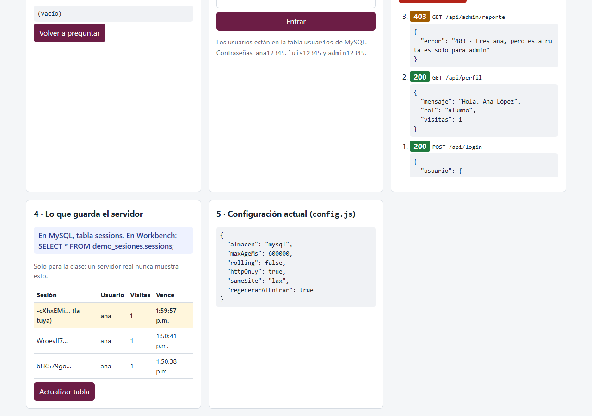
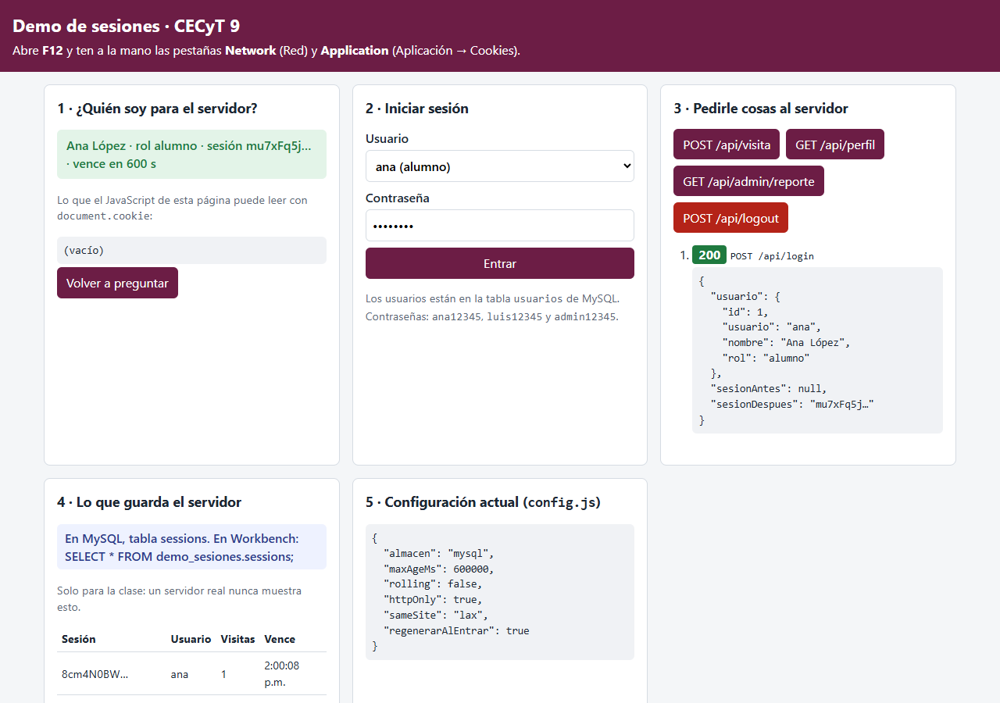
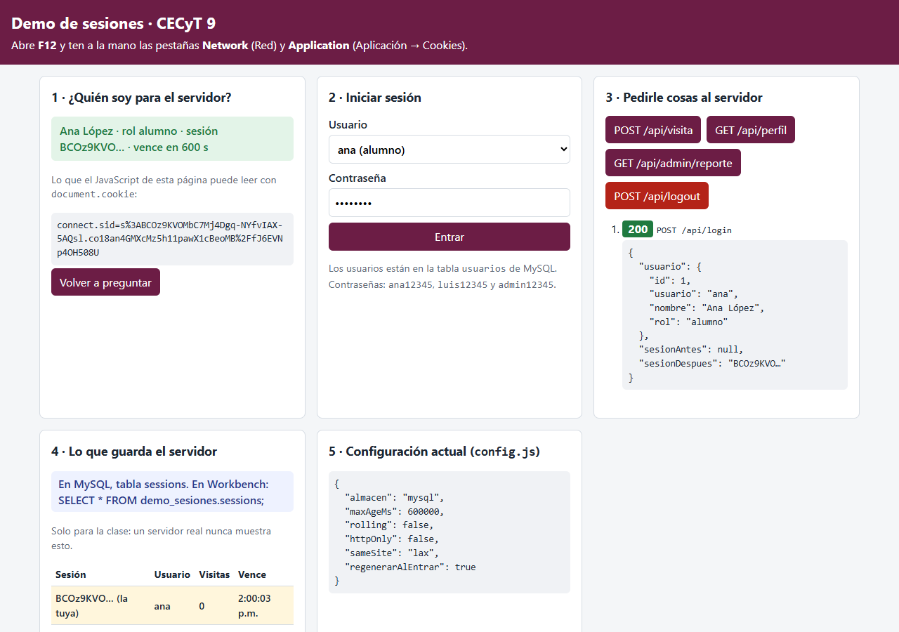
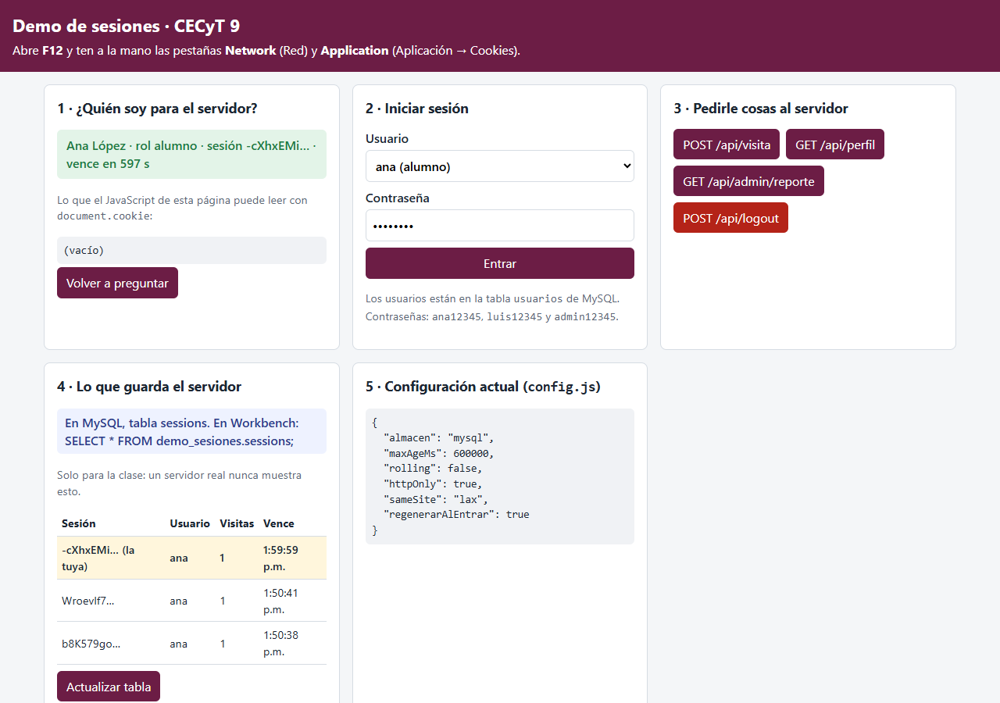
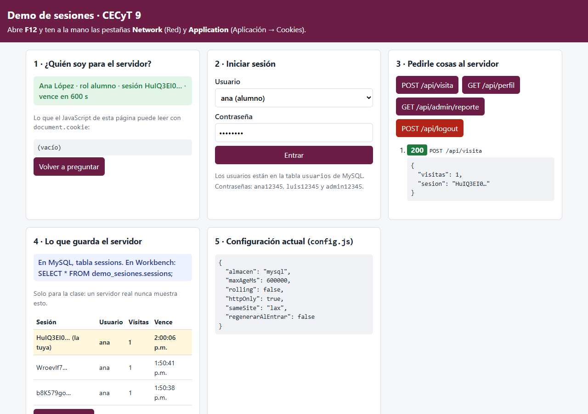

# Demo guiada — ¿Cómo funciona una sesión?

**Programación Web · Parcial 3 · semana 12 (9 al 13 de noviembre) · en clase, con tu docente**

En el Corte 2 hiciste un login con `express-session`. Funcionaba, pero casi todo pasaba "por dentro". Hoy lo vamos a
**programar juntos, paso por paso**, y después de cada paso lo vas a **ver**: qué viaja entre el navegador y el
servidor, qué guarda cada uno (incluida la **base de datos**), cuándo se acaba una sesión y cómo se la pueden robar.
Lo que observes hoy lo usas en la **matriz de riesgos** de esta semana.

Así se ve la demo terminada:



## Lo que vas a aprender

1. Qué es la **cookie de sesión**: el servidor la manda con `Set-Cookie` y el navegador la regresa sola en cada petición.
2. Qué guarda el **navegador** (solo un id firmado) y qué guarda el **servidor** (quién eres, tu rol, tus datos), y por qué conviene guardar las sesiones en la **base de datos**.
3. Cuándo responde **401** ("no sé quién eres") y cuándo **403** ("sé quién eres, pero no puedes").
4. Para qué sirven `maxAge`, `httpOnly`, `sameSite` y `secure`.
5. Cómo se **secuestra** una sesión (robando la cookie) y cómo se **fija** (plantando una), y qué controles lo evitan.

## Antes de empezar (10 min)

Necesitas **Node.js 18 o más nuevo**, **MySQL 8 encendido** (el mismo de siempre; también funciona con MariaDB/XAMPP),
**MySQL Workbench** y **Google Chrome**. Trabajas en la carpeta `base/`: ya trae el frontend, la conexión a MySQL y la
**base de datos completa**. Lo que falta del backend lo programamos en clase.

1. Instala las dependencias:

   ```bash
   cd parcial-3-jwt-dashboard-websockets/semana-12/demo-sesiones/base
   npm install
   ```

2. Copia `.env.example` con el nombre `.env` y escribe **tu** contraseña de MySQL en `DB_PASSWORD`
   (`copy .env.example .env` en PowerShell o CMD).

3. Carga la base de datos que te damos. Ya trae todo: la tabla `usuarios` (ana, luis y admin, con su contraseña en
   hash) y la tabla `sessions`, vacía. Elige **una** forma:
   - **Workbench:** *File → Open SQL Script…* → `bd/demo_sesiones.sql` → botón del rayo (*Execute*).
   - **Terminal:** `npm run bd`

4. Arranca:

   ```bash
   npm start
   ```

   ```text
   Demo de sesiones en http://localhost:4600
   Usuarios en MySQL: 3 (ana / ana12345 · luis / luis12345 · admin / admin12345)
   Las sesiones se guardan en: MySQL (tabla sessions)
   ```

5. En Workbench, deja abierta una pestaña de consulta con esto (la vas a ejecutar varias veces con **Ctrl+Enter**):

   ```sql
   SELECT * FROM demo_sesiones.sessions;
   ```

Abre `http://localhost:4600` y abre **F12**. Vas a usar dos pestañas de las herramientas:

- **Network** (Red): cada petición, con sus encabezados (*Headers*).
- **Application** (Aplicación) → **Cookies** → `http://localhost:4600`: las cookies que guarda el navegador.

Al principio, casi todos los botones responden **501 · Falta programarlo en clase (paso N)**. Es normal: cada paso
que programemos va quitando un 501.

| Archivo | Qué es |
|---|---|
| ✏️ `app.js` | El servidor: la sesión, los middlewares `requiereSesion` y `requiereRol`, y las rutas de login y logout. Lo marcado con `(en clase)` lo programamos juntos |
| ✏️ `modelos/usuarios.modelo.js` | La función `verificar`: busca al usuario en la tabla `usuarios` y compara la contraseña (paso 2) |
| `config.js` | Las opciones de la sesión, incluido **dónde** se guardan (`almacen`). Las vas a cambiar en los pasos 4, 5 y 7 |
| `db.js`, `.env` | La conexión a MySQL (ya hecha) |
| `bd/demo_sesiones.sql` | La base completa: tablas `usuarios` y `sessions` (`npm run bd` carga este mismo archivo) |
| `public/` | El frontend (HTML, CSS y JavaScript con `fetch`), ya hecho |
| `pruebas/probar.js` | Pruebas automáticas: al terminar la clase, `npm run probar` debe dar 21 de 21 |

> Cada vez que cambies un archivo del servidor (`app.js`, `modelos/`, `config.js`): **Ctrl+C** en la terminal y otra
> vez `npm start`. Luego recarga la página.

---

## Paso 1 — Configurar la sesión y responder 401 (10 min)

**En clase programamos** (`app.js`): `express-session` con su almacén y la cookie `connect.sid`, y el middleware
`requiereSesion`.

1. **Antes** de programar, pulsa **GET /api/perfil**: responde 501.
2. Después de programar y reiniciar, vuelve a pulsarlo.
3. En **Application → Cookies**, revisa si hay alguna cookie.

**Observa**

- [ ] Ahora la respuesta es **401**. El servidor no sabe quién eres.
- [ ] No hay ninguna cookie. El servidor no crea una sesión hasta que tiene algo que guardar (`saveUninitialized: false`).

---

## Paso 2 — Iniciar sesión: el `Set-Cookie` (15 min)

**En clase programamos:** `verificar` en `modelos/usuarios.modelo.js` (`SELECT ... WHERE usuario = ?` y
`bcrypt.compare`), y las rutas `POST /api/login` y `POST /api/logout` en `app.js`.

1. Con **ana** seleccionada, pulsa **Entrar**.
2. En **Network**, haz clic en la petición `login` → **Headers** → **Response Headers**. Busca `Set-Cookie`.
3. Ahora pulsa **GET /api/perfil** y, en **Network**, abre esa petición → **Request Headers**. Busca `Cookie`.
4. Ve a **Application → Cookies** y mira la cookie `connect.sid`.

**Observa**

- [ ] La respuesta del login trae algo como
      `Set-Cookie: connect.sid=s%3ArMq2…; Path=/; Expires=…; HttpOnly; SameSite=Lax`.
- [ ] En la siguiente petición, el navegador manda **solo** `Cookie: connect.sid=s%3ArMq2…`. Tú no programaste eso: el navegador lo hace siempre.
- [ ] El valor de la cookie **no** dice "ana" ni "alumno". Es un **id** con una **firma** (lo que va después del punto).
- [ ] La tabla **4 · Lo que guarda el servidor** muestra tu sesión con usuario `ana`. **Los datos están en el servidor**; el navegador solo tiene la "llave".
- [ ] En Workbench, `SELECT * FROM demo_sesiones.sessions;` ahora tiene **una fila**. `session_id` es el mismo id que va
      en la cookie (sin el `s:` del principio ni la firma), `expires` es cuándo vence, y en `data` está el JSON con tu
      usuario y tu rol. Esa fila es la sesión.
- [ ] Con una contraseña equivocada responde **401** y no se crea cookie. La contraseña nunca se guarda ni se compara en texto plano: solo su hash.

> La firma la hace el servidor con su `secret`. Si alguien cambia el id a mano, la firma ya no coincide y el
> servidor lo ignora. Por eso **no se puede inventar** una sesión... pero sí se puede **robar** una que ya existe (paso 6).

---

## Paso 3 — 401 contra 403 (10 min)

**En clase programamos** (`app.js`): el middleware `requiereRol(rol)`.

1. Como **ana**, pulsa **GET /api/admin/reporte**.
2. Cierra sesión, entra como **admin** y vuelve a pulsarlo.
3. Cierra sesión y pulsa **GET /api/admin/reporte** otra vez.

**Observa** y llena la tabla:

| Situación | Código | ¿Qué significa? |
|---|---|---|
| Sin sesión | | |
| Con sesión de ana | | |
| Con sesión de admin | | |

En `app.js`, ¿en qué orden se aplican `requiereSesion` y `requiereRol` en la ruta `/api/admin/reporte`? ¿Qué pasaría
si se invirtiera el orden?

---

## Paso 4 — ¿Dónde guarda el servidor las sesiones? (10 min)

**En este paso no se programa:** solo se cambia `almacen` en `config.js`.

1. Inicia sesión como ana y pulsa **GET /api/perfil** varias veces. El número de `visitas` crece. Ejecuta otra vez la
   consulta en Workbench: el contador está en la columna `data`. Vive **en la base de datos**, no en el navegador.
2. Detén el servidor (**Ctrl+C**) y vuelve a correr `npm start`. **No** recargues la página: pulsa **Volver a preguntar**.
3. Ahora en `config.js` cambia `almacen` a `'memoria'`. Reinicia, recarga la página, inicia sesión y repite el paso 2.
4. Regresa `almacen` a `'mysql'` y reinicia.



**Observa**

- [ ] Con `'mysql'`, después de reiniciar **sigues con sesión**: el servidor nuevo leyó la fila de la tabla `sessions`.
- [ ] Con `'memoria'`, la cookie **sigue** en el navegador pero el servidor responde **401**: la sesión estaba en la
      memoria del proceso (`MemoryStore`) y se borró al reiniciar. Y en Workbench la tabla `sessions` no cambia: no se usó.
- [ ] Al hacer **logout** con `'mysql'`, la fila desaparece de la tabla.

> Por eso en producción las sesiones van en una base de datos (MySQL, Redis...): sobreviven a un reinicio o a un
> nuevo despliegue, y si hay **varios servidores** atendiendo, todos ven las mismas sesiones.

---

## Paso 5 — Opciones de la cookie (15 min)

**En clase programamos** (`app.js`): la función `vencida(sesion)` y su revisión dentro de `requiereSesion`. Así es el
**servidor** el que decide cuándo vence una sesión, no solo el navegador.

### 5.1 `maxAge`: ¿cuánto dura?

1. En `config.js` cambia `maxAgeMs` a `20 * 1000` (20 segundos). Reinicia el servidor y recarga la página.
2. Inicia sesión y espera 25 segundos **sin tocar nada**. Pulsa **GET /api/perfil**.
3. Ahora cambia `rolling` a `true`, reinicia, inicia sesión y pulsa **GET /api/perfil** cada 10 segundos durante un minuto.

**Observa**

- [ ] Con `rolling: false`, a los 20 s responde **401** aunque estuvieras usando la página. La sesión vence a una hora fija.
- [ ] Con `rolling: true`, mientras la uses no vence. En Network, **cada** respuesta trae un `Set-Cookie` nuevo con otro `Expires`. Vence solo por **inactividad**.

Regresa `maxAgeMs` a `10 * 60 * 1000` y `rolling` a `false`.

### 5.2 `httpOnly`: ¿la puede leer JavaScript?

1. Con la sesión iniciada, mira el recuadro **document.cookie** de la página, o escribe `document.cookie` en la **Console**.
2. Cambia `httpOnly` a `false`, reinicia, recarga e inicia sesión. Vuelve a mirar.

**Observa**



- [ ] Con `httpOnly: true` sale vacío: el JavaScript **no** puede leer la cookie.
- [ ] Con `httpOnly: false` aparece `connect.sid=...`. Si la página tuviera un hueco de **XSS** (un script que alguien
      logró meter, por ejemplo en un comentario), ese script podría leerla y mandársela a otro servidor.

Regresa `httpOnly` a `true`.

### 5.3 `sameSite` y `secure` (solo se explican)

- `sameSite: 'lax'`: si **otra página** (otro sitio) intenta mandar un `POST` a tu servidor, el navegador **no** pega
  la cookie. Así se frena el ataque **CSRF** (hacer acciones a nombre del usuario desde otro sitio).
- `secure: true`: la cookie **solo** viaja por **HTTPS**. Aquí está en `false` porque usamos `http://localhost`; en
  Render o en cualquier servidor real va en `true`. Sin HTTPS, cualquiera en la misma red WiFi podría leerla.

---

## Paso 6 — Secuestro de sesión (10 min)

**En este paso no se programa:** usamos el logout del paso 2.

Tú eres la **víctima** en tu ventana normal. El **atacante** es otra ventana: abre una **ventana de incógnito**
(**Ctrl+Shift+N**), que es como otro navegador con sus propias cookies.

1. **Víctima** (ventana normal): inicia sesión como ana. En **Application → Cookies**, haz doble clic en el **Value**
   de `connect.sid` y cópialo completo.
2. **Atacante** (incógnito): abre `http://localhost:4600` y abre F12. Está **sin sesión**. En la **Console** escribe
   (pega el valor que copiaste):

   ```js
   document.cookie = 'connect.sid=PEGA_AQUI_EL_VALOR; path=/';
   ```

   > Si Chrome no te deja pegar, escribe `allow pasting`, Enter, y vuelve a pegar.

3. **Atacante**: pulsa **Volver a preguntar** y luego **GET /api/perfil**.
4. **Víctima**: pulsa **POST /api/logout**. **Atacante**: pulsa **Volver a preguntar**.



**Observa**

- [ ] El atacante es **Ana López**, sin haber escrito ninguna contraseña. Para el servidor, quien trae la cookie **es** el usuario.
- [ ] En la tabla del servidor (y en Workbench), víctima y atacante usan **la misma** fila de sesión.
- [ ] Cuando la víctima cierra sesión, el atacante queda **fuera** (401). El logout **destruye** la sesión en el servidor
      (`req.session.destroy`), así que la cookie robada ya no sirve. Por eso hay que poner un botón de **Cerrar sesión**
      y una **expiración**: limitan cuánto tiempo sirve una cookie robada.

---

## Paso 7 — Fijación de sesión (15 min)

En el secuestro el atacante **roba** una cookie. En la **fijación** hace lo contrario: **planta** su propia cookie en
el navegador de la víctima y espera a que ella inicie sesión. Primero lo vemos funcionar con el login tal como lo
programamos en el paso 2 (conserva el mismo id) y después lo corregimos.

1. **Víctima** (ventana normal): si tienes sesión, pulsa **POST /api/logout**.
2. **Atacante** (incógnito): recarga, pulsa **POST /api/visita** (crea una sesión sin usuario) y copia el **Value** de su `connect.sid`.
3. **Víctima**: en la Console escribe `document.cookie = 'connect.sid=VALOR_DEL_ATACANTE; path=/';` y luego **inicia sesión como ana**.
4. **Atacante**: pulsa **Volver a preguntar**.



**En clase programamos** (`app.js`, en el login): `req.session.regenerate`, controlado por `regenerarAlEntrar` en `config.js`.

5. Reinicia y repite los pasos 1 a 4.
6. Para volver a ver el problema, cambia `regenerarAlEntrar` a `false` en `config.js` y reinicia. Al terminar, regrésalo a `true`.

**Observa**

- [ ] Antes de programar este paso (o con `regenerarAlEntrar: false`), el atacante queda **dentro** como Ana: la víctima inició sesión **sobre** la sesión que el atacante ya conocía.
- [ ] Con `regenerarAlEntrar: true`, el atacante sigue **sin sesión**. En la respuesta del login, `sesionAntes` y
      `sesionDespues` son **distintos**: al entrar, el servidor crea una sesión **nueva**.

---

## Al terminar

```bash
npm run probar
```

Debe decir `21 de 21 pruebas pasaron.`. Las pruebas usan su propia base (`demo_sesiones_pruebas`) y no tocan tus datos.
Si alguna falla, el nombre de la prueba dice qué paso revisar.

## Para tu matriz de riesgos

Con lo que viste, completa estas filas en la matriz de riesgos de la semana (amenaza / probabilidad / impacto / control):

| Amenaza | ¿Qué lo hace posible? | Control que viste hoy |
|---|---|---|
| Robo de la cookie con un script (XSS) | | |
| Robo de la cookie en una red WiFi abierta | | |
| Cookie robada que sirve para siempre | | |
| Fijación de sesión | | |
| Un alumno entra a una ruta de administrador | | |

**Preguntas**

1. ¿Por qué decimos que la cookie de sesión es como la **llave** de un casillero y no como el contenido del casillero?
2. Si el servidor guarda las sesiones en memoria, ¿qué pasa con los usuarios cuando se reinicia? ¿Y si hubiera **dos** servidores atendiendo a la vez? ¿Qué cambia con la tabla `sessions`?
   Y si alguien lograra leer la tabla `sessions` (por ejemplo con una inyección SQL), ¿qué podría hacer con los `session_id`?
3. En la semana 13 cambiarás la sesión por **JWT**. Con JWT, los datos del usuario viajan **dentro** del token y el servidor no guarda nada. Según lo que viste en el paso 6, ¿qué se vuelve más difícil con JWT: cerrar la sesión de alguien a quien le robaron el token, o saber quién es el usuario?

## Problemas comunes

| Síntoma | Causa probable | Solución |
|---|---|---|
| Un botón responde `501 · Falta programarlo en clase (paso N)` | Ese paso todavía no se programa, o no reiniciaste el servidor | Revisa el paso N; Ctrl+C y `npm start` |
| `Error: listen EADDRINUSE :::4600` | Ya tienes la demo corriendo en otra terminal | Ciérrala, o arranca con otro puerto: `set PORT=4601` (CMD), `$env:PORT=4601` (PowerShell) |
| Cambié un archivo y no pasa nada | El servidor no se reinicia solo | Ctrl+C y `npm start`, y recarga la página |
| La API responde `500 · Error del servidor` | Un error en el código que escribimos | Mira la terminal del servidor: ahí sale el error real (archivo y línea) |
| El atacante sigue sin sesión después de pegar la cookie | Faltó una parte del valor (es largo) o las comillas | Copia el **Value** completo con doble clic, y revisa que quede dentro de `'...'` |
| En la fijación, el atacante no entra antes de programar el paso 7 | La víctima ya tenía su propia cookie y `document.cookie` no puede sobrescribir una cookie `HttpOnly` | Primero haz **logout** en la víctima (paso 7.1) y después planta la cookie |
| `Cannot find module 'express-session'` (o `mysql2`, `dotenv`) | No corriste `npm install` | `npm install` dentro de `base` |
| `No me pude conectar a MySQL: connect ECONNREFUSED` | MySQL está apagado | Servicios de Windows → **MySQL80** → Iniciar |
| `Access denied for user 'root'` | La contraseña de tu `.env` está mal | Corrige `DB_PASSWORD` en `.env` |
| `Unknown database 'demo_sesiones'` o `Table ... doesn't exist` | No cargaste la base | Importa `bd/demo_sesiones.sql` en Workbench o corre `npm run bd` |
| La tabla `sessions` sale vacía en Workbench | No volviste a ejecutar la consulta, o tienes `almacen: 'memoria'` | Ctrl+Enter otra vez; revisa `config.js` |
