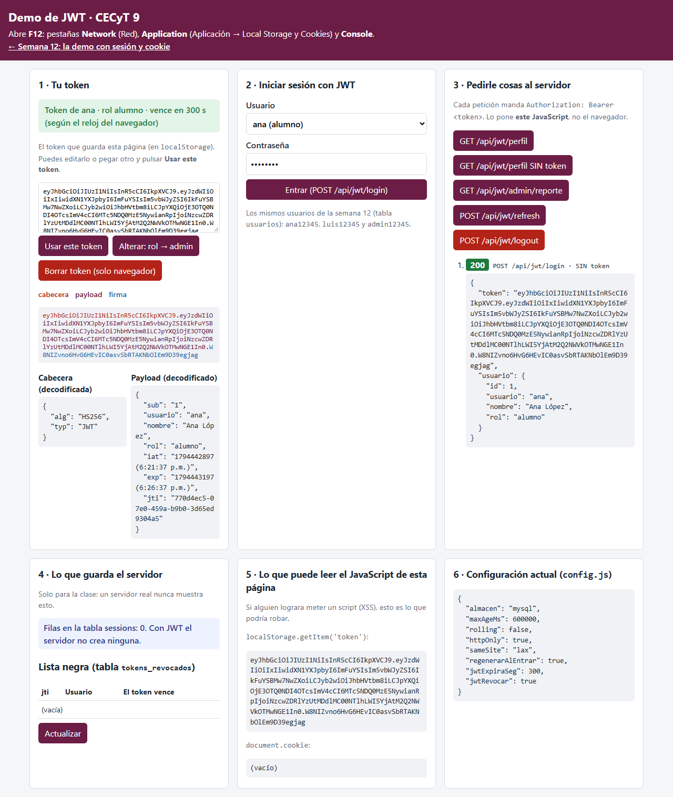
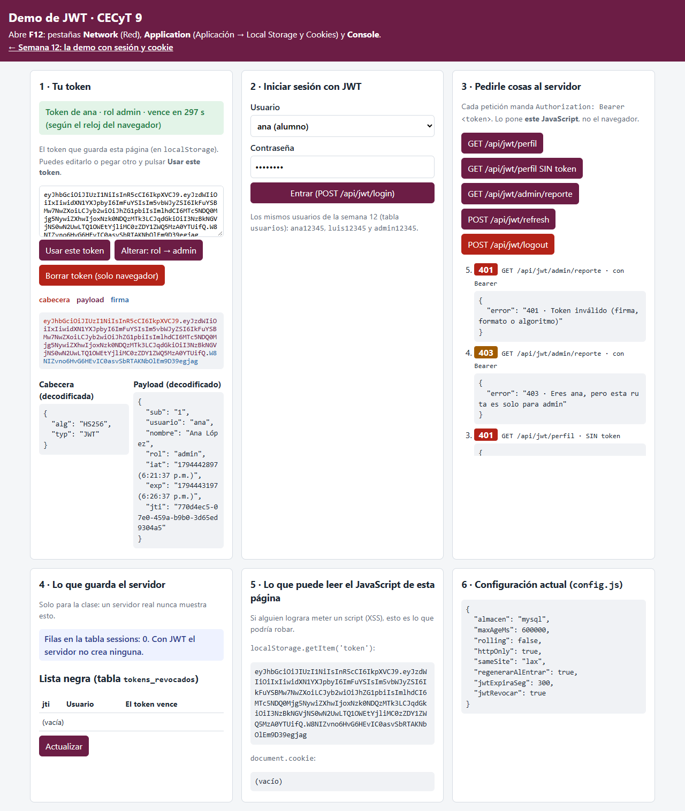
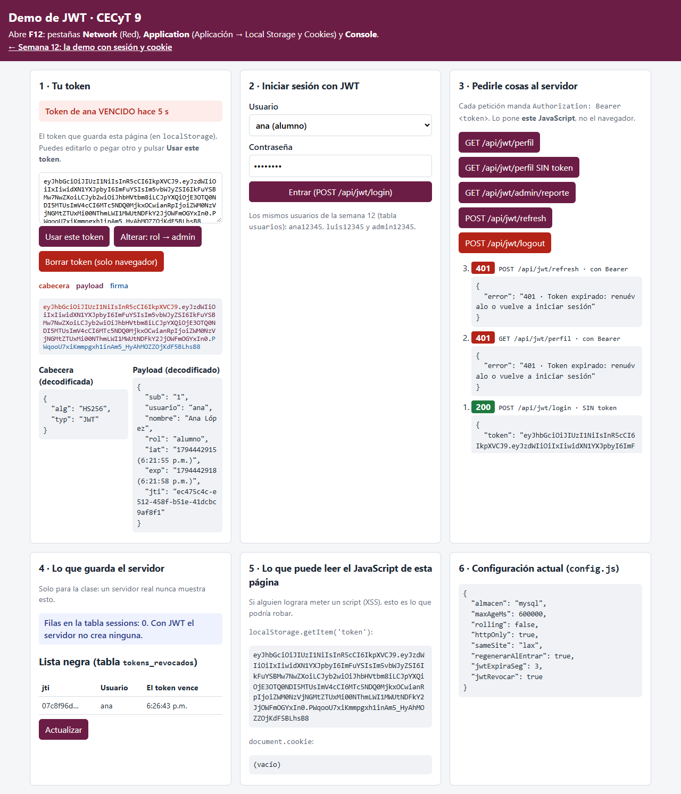
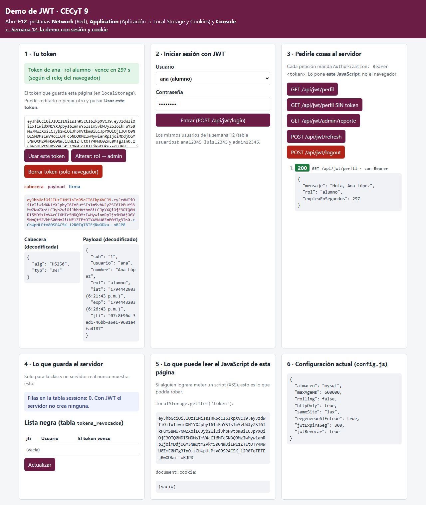
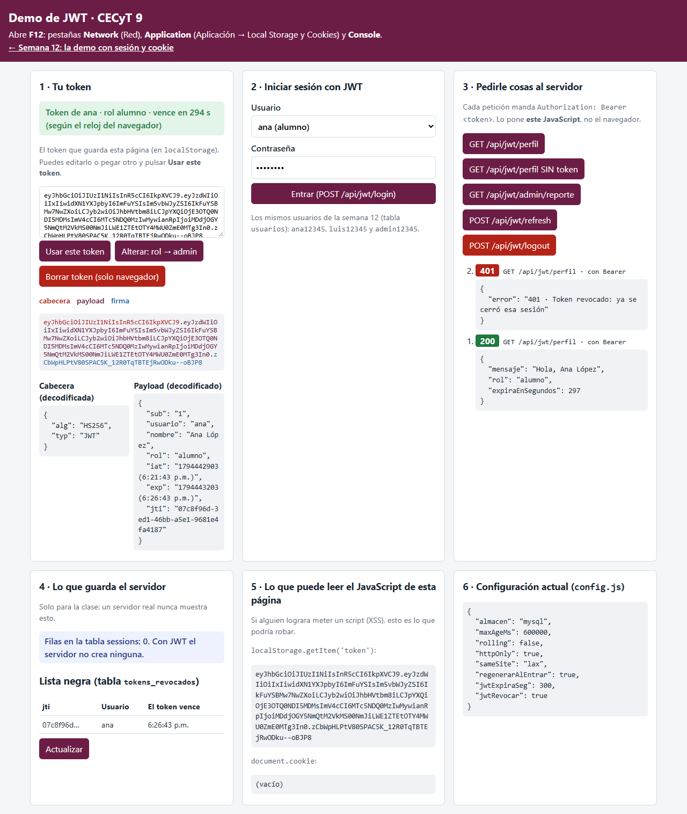

# Demo guiada — De la sesión al JWT

**Programación Web · Parcial 3 · semana 13 (16 al 20 de noviembre) · en clase, con tu docente**

En la semana 12 programaste una sesión con cookie: el servidor guarda quién eres (en la tabla `sessions`) y el
navegador solo lleva una llave. Hoy, en **la misma app**, vamos a programar la otra forma de autenticar: el **JWT**
(JSON Web Token). Aquí el servidor **no guarda nada**: todo lo que necesita saber va **dentro del token**, firmado.
Lo vamos a programar juntos, paso por paso, y después de cada paso lo vas a **ver** y **comparar** con la sesión.

Esto es justo lo que después vas a llevar a tu proyecto en la integradora de esta semana (login que emite JWT,
middleware que lo verifica y `fetchConToken` en el frontend).



## Lo que vas a aprender

1. Qué es un JWT: **cabecera, payload y firma**, y por qué el payload **se puede leer** pero **no se puede cambiar**.
2. Cómo viaja: en el encabezado `Authorization: Bearer <token>`, que pone **tu código**, no el navegador.
3. 401 contra 403 con JWT: el rol viene **dentro** del token.
4. Expiración (`exp`) y renovación (`refresh`).
5. Qué pasa si te **roban** el token y por qué **cerrar sesión no basta**… hasta que programamos una **lista negra**.

### Sesión contra JWT (la vas a ir llenando con lo que observes)

| Pregunta | Sesión (semana 12) | JWT (hoy) |
|---|---|---|
| ¿Qué guarda el servidor? | Una fila en `sessions` | |
| ¿Qué lleva el navegador? | Una cookie con un id firmado | |
| ¿Quién lo manda en cada petición? | El navegador, solo | |
| ¿Dónde está el rol? | En el servidor | |
| ¿Y si reinicio el servidor? | Depende del almacén | |
| ¿Cerrar sesión lo invalida? | Sí (`destroy`) | |
| ¿Lo puede leer el JavaScript de la página? | No (`httpOnly`) | |

## Antes de empezar (10 min)

Partes de la semana 12 **terminada**. La carpeta `base/` de esta demo ya trae todo lo de la semana 12 resuelto (la
sesión, `demo.js`, las pruebas) más lo nuevo: la página `jwt.html` (ya hecha), la librería `jsonwebtoken` y la tabla
`tokens_revocados`. Lo que enseña JWT en el servidor está vacío y lo programamos en clase.

1. Instala las dependencias (ahora incluye `jsonwebtoken`):

   ```bash
   cd parcial-3-jwt-dashboard-websockets/semana-13/demo-jwt/base
   npm install
   ```

2. Crea tu `.env`: copia `.env.example` como `.env` (o copia el de tu semana 12) y revisa que tenga **tu**
   `DB_PASSWORD` y la línea nueva `JWT_SECRET=...`.

3. Vuelve a cargar la base: trae la tabla nueva `tokens_revocados`. **Workbench:** *File → Open SQL Script… →
   `bd/demo_sesiones.sql` → rayo*. **Terminal:** `npm run bd`. (Borra la base `demo_sesiones` y la crea de nuevo: las
   sesiones de la semana 12 se pierden, los usuarios son los mismos.)

4. Arranca con `npm start`. Además de lo de la semana 12, debe decir:

   ```text
   Página de JWT (semana 13): http://localhost:4600/jwt.html
   ```

5. Abre `http://localhost:4600/jwt.html` y **F12**. Vas a usar **Network** (Red), **Application → Local Storage** y
   **Console**. En Workbench deja lista: `SELECT * FROM demo_sesiones.sessions;`

Al principio, casi todos los botones responden **501 · Falta programarlo en clase (paso N)**. Cada paso quita un 501.

| Archivo | Qué es |
|---|---|
| ✏️ `app.js` | Al final, la sección **SEMANA 13 · JWT**: `firmarToken`, `requiereJWT`, `requiereRolJWT` y las rutas `/api/jwt/...`. Lo de la semana 12 ya está hecho |
| ✏️ `modelos/tokens.modelo.js` | La lista negra: `revocar` y `estaRevocado` (paso 7) |
| `config.js` | Lo de la semana 12 más `jwtExpiraSeg` (cuántos **segundos** dura un token) y `jwtRevocar` (paso 7) |
| `.env` | `JWT_SECRET`: con qué se firman los tokens (paso 4) |
| `public/jwt.html`, `public/jwt.js` | La página de JWT, ya hecha. **Léela**: `jwt.js` guarda el token en `localStorage` y lo manda en `Authorization` |
| `public/index.html`, `public/demo.js` | La página de la semana 12 (con un enlace a la de JWT) |
| `pruebas/probar.js` | Las 21 pruebas de la semana 12 + 20 de JWT: al terminar la clase, `npm run probar` debe dar **41 de 41** |

> Cada vez que cambies `app.js`, `modelos/`, `config.js` o `.env`: **Ctrl+C** y otra vez `npm start`. Luego recarga
> la página.

---

## Paso 1 — Iniciar sesión con JWT: firmar el token (15 min)

**En clase programamos** (`app.js`): la función `firmarToken(usuario)` con `jwt.sign` (payload con `sub`,
`usuario`, `nombre` y `rol`; algoritmo `HS256`; `expiresIn` desde `config.jwtExpiraSeg`; un `jwtid` único) y la ruta
`POST /api/jwt/login`, que usa el mismo `verificar` de la semana 12.

1. **Antes** de programar, pulsa **Entrar**: responde 501.
2. Después de programar y reiniciar, entra como **ana**.
3. En **Network**, abre la petición `login` → **Headers** → **Response Headers**. ¿Hay `Set-Cookie`?
4. En **Application → Local Storage → `http://localhost:4600`**, busca la clave `token`.
5. En Workbench ejecuta otra vez `SELECT * FROM demo_sesiones.sessions;`.
6. Mira la tarjeta **1 · Tu token**: las tres partes de colores y el payload decodificado. En la **Console** escribe
   `atob(localStorage.getItem('token').split('.')[1])`.

**Observa**

- [ ] El token son **tres partes** separadas por puntos: cabecera, payload y firma.
- [ ] El login **no** manda `Set-Cookie` y **no** aparece ninguna fila nueva en `sessions`. El servidor no guardó nada.
- [ ] El token quedó en `localStorage` porque **`jwt.js` lo guardó ahí**. El servidor solo lo entregó en el JSON.
- [ ] Con `atob` lees el payload **sin ninguna clave**: `usuario`, `nombre`, `rol`, `iat`, `exp`, `jti`. El payload
      **no va cifrado**, solo codificado. Por eso **nunca** debe llevar la contraseña ni datos sensibles.
- [ ] `exp - iat` = 300: los segundos de `jwtExpiraSeg`.

---

## Paso 2 — Verificar el token: `requiereJWT` (15 min)

**En clase programamos** (`app.js`): el middleware `requiereJWT`. Lee el encabezado `Authorization`, exige que
empiece con `Bearer `, verifica el token con `jwt.verify` (solo `HS256`) y deja el payload en `req.jwt`. Si algo
falla: **401**.

1. Pulsa **GET /api/jwt/perfil SIN token** y luego **GET /api/jwt/perfil**.
2. En **Network**, abre la segunda → **Request Headers**. Busca `Authorization`.
3. Detén el servidor, cambia `almacen` a `'memoria'` en `config.js`, arranca otra vez y, **sin volver a entrar**,
   pulsa **GET /api/jwt/perfil**. Después regresa `almacen` a `'mysql'`.

**Observa**

- [ ] Sin token: **401** «Falta el token». Con token: **200** «Hola, Ana López».
- [ ] La petición lleva `Authorization: Bearer eyJ…`. Ese encabezado lo puso **`jwt.js`** (busca `Authorization` en
      el archivo). Con la sesión, la cookie la ponía el navegador solo.
- [ ] Después de reiniciar, **incluso con `'memoria'`**, el token **sigue sirviendo**. El servidor no tenía nada que
      perder: con el secreto le basta para comprobar la firma. A esto se le llama **sin estado** (*stateless*).

> Si te quedó una cookie `connect.sid` de la semana 12, el navegador también la manda, pero las rutas `/api/jwt/...`
> no la usan.

---

## Paso 3 — 401 contra 403 con JWT (10 min)

**En clase programamos** (`app.js`): el middleware `requiereRolJWT(rol)`, que compara el rol que viene **dentro del
token** (`req.jwt.rol`).

1. Como **ana**, pulsa **GET /api/jwt/admin/reporte**.
2. Entra como **admin** y vuelve a pulsarlo.
3. Pulsa **Borrar token (solo navegador)** y vuelve a pulsarlo.

**Observa** y llena la tabla:

| Situación | Código | ¿Qué significa? |
|---|---|---|
| Sin token | | |
| Con token de ana | | |
| Con token de admin | | |

¿En qué orden van `requiereJWT` y `requiereRolJWT` en la ruta? ¿Qué pasaría con alguien sin token si se invierten?

---

## Paso 4 — ¿Qué protege la firma? (15 min)

**En este paso no se programa.**

### 4.1 Alterar el token

1. Entra como **ana**. Pulsa **Alterar: rol → admin**: la página cambia `"rol": "alumno"` por `"admin"` dentro del
   payload y deja la firma original.
2. Mira el estado de la tarjeta 1 y pulsa **GET /api/jwt/admin/reporte**.



- [ ] El estado (el reloj y los datos **del navegador**) dice «rol admin»: el navegador se cree cualquier cosa.
- [ ] El servidor responde **401 · Token inválido**: la firma se calculó sobre el payload original. Si cambias **una
      letra**, la firma ya no coincide. Para firmar un payload nuevo hace falta el **secreto**, y solo lo tiene el servidor.

### 4.2 Cambiar el secreto

1. Con un token válido de ana, cambia `JWT_SECRET` en tu `.env`, reinicia y pulsa **GET /api/jwt/perfil**.
2. Entra otra vez y repite.

- [ ] Con el secreto nuevo, **todos** los tokens anteriores dan 401. El token nuevo sí funciona.
- [ ] Si alguien **roba el secreto** (por ejemplo, porque se subió el `.env` a GitHub), puede **fabricar** tokens de
      admin. Por eso el secreto va en `.env` y `.env` va en `.gitignore`.

### 4.3 El ataque `alg: none` (solo se explica)

Un JWT dice en su cabecera con qué algoritmo se firmó. Hubo librerías que aceptaban `"alg": "none"` (**sin firma**):
cualquiera fabricaba un token de admin. En `requiereJWT` escribimos `algorithms: ['HS256']`: el servidor decide el
algoritmo, no el token. (Las pruebas automáticas lo comprueban.)

### 4.4 ¿Dónde vive el token en el navegador?

1. Mira la tarjeta **5 · Lo que puede leer el JavaScript de esta página**.

- [ ] `localStorage.getItem('token')` muestra el token completo. Un script metido por **XSS** lo podría leer y mandar
      a otro servidor. En la semana 12, con `httpOnly`, la cookie era invisible para el JavaScript.
- [ ] A cambio, el token **no** viaja solo: otro sitio no puede hacer que tu navegador lo mande. Por eso el JWT en
      `Authorization` **no sufre CSRF**, y la cookie sí (por eso existía `sameSite`).

---

## Paso 5 — Expiración y renovación (15 min)

**En clase programamos** (`app.js`): en el `catch` de `requiereJWT`, distinguir un token **vencido**
(`TokenExpiredError`) de uno **alterado**, y la ruta `POST /api/jwt/refresh`, que con un token **todavía válido**
entrega uno nuevo con el reloj reiniciado.

1. En `config.js` cambia `jwtExpiraSeg` a `30`. Reinicia, recarga y entra como ana.
2. Mira la cuenta regresiva del estado. Cuando falten unos 15 s, pulsa **POST /api/jwt/refresh** y compara el `exp`
   y el `jti` del payload antes y después.
3. Ahora espera a que el estado diga **VENCIDO** y pulsa **GET /api/jwt/perfil** y luego **POST /api/jwt/refresh**.
4. Regresa `jwtExpiraSeg` a `5 * 60`.



**Observa**

- [ ] El refresh entrega un token **nuevo**: otro `jti` y un `exp` 30 s más adelante.
- [ ] Vencido: **401 · Token expirado** (antes de este paso decía solo «Token inválido»). El mensaje distinto le dice
      al frontend qué hacer: si expiró, mandar al login.
- [ ] Con el token vencido, el refresh **también** da 401: solo se renueva lo que todavía es válido. Si no, un token
      robado se podría renovar para siempre.
- [ ] La cuenta regresiva de la página la calcula el **navegador**; quien decide es el **servidor**.

---

## Paso 6 — Robo del token y un logout que no sirve (10 min)

**En este paso no se programa:** el logout que trae la base solo responde. Tú eres la **víctima** en tu ventana
normal; el **atacante** es una **ventana de incógnito** (**Ctrl+Shift+N**).

1. **Víctima:** entra como ana y copia todo el texto del cuadro del token.
2. **Atacante:** abre `http://localhost:4600/jwt.html`, pega el token en el cuadro, pulsa **Usar este token** y luego
   **GET /api/jwt/perfil**.
3. **Víctima:** pulsa **POST /api/jwt/logout**. **Atacante:** pulsa otra vez **GET /api/jwt/perfil**.



**Observa**

- [ ] El atacante es **Ana López** sin contraseña. Igual que con la cookie: quien trae el token **es** el usuario.
- [ ] Después del logout de la víctima, el atacante **sigue dentro** (200). La respuesta del logout lo dice:
      «El servidor no guarda nada». El logout solo borró el token **del navegador de la víctima**.
- [ ] Compáralo con la semana 12: ahí `destroy` borraba la fila de `sessions` y la cookie robada dejaba de servir.
      Con JWT, un token robado sirve **hasta que vence**. Por eso los JWT duran poco.

---

## Paso 7 — La lista negra (15 min)

**En clase programamos:** en `modelos/tokens.modelo.js`, `revocar` (INSERT en `tokens_revocados`) y `estaRevocado`
(SELECT por `jti`); en `app.js`, que el logout anote el token cuando `config.jwtRevocar` es `true`, y que
`requiereJWT` rechace los tokens anotados.

1. Repite el paso 6 completo (con un login nuevo de la víctima).
2. En Workbench: `SELECT * FROM demo_sesiones.tokens_revocados;`. En la página, tarjeta 4 → **Actualizar**.
3. Cambia `jwtRevocar` a `false`, reinicia y repite. Regrésalo a `true`.



**Observa**

- [ ] Con `jwtRevocar: true`, después del logout el atacante recibe **401 · Token revocado**.
- [ ] En la tabla hay una fila con el `jti` (el id del token, **no** el token completo), el usuario y cuándo vencía.
- [ ] Si ana tenía otro token (por ejemplo, en el celular), ese **sigue sirviendo**: solo se revocó uno.
- [ ] Para revocar, el servidor **volvió a guardar algo** y a consultar MySQL en cada petición. JWT ya no es del
      todo «sin estado»: es el precio de poder cerrar sesión de verdad.

---

## Pruebas y evidencias

Haz cada prueba desde la página `jwt.html` (con F12) o desde **Postman**. En Postman, el token va en la pestaña
**Authorization → Type: Bearer Token**, o como encabezado `Authorization: Bearer <token>`. Postman **no** guarda el
token solo (no es una cookie): lo copias de la respuesta del login.

Guarda cada captura como `P-XX.png` en una carpeta `evidencias/`. Los tokens, `jti` y horas serán distintos en tu
equipo; lo que importa es la forma y si cambian o no.

### P-01 · Login con JWT

| | |
|---|---|
| **Qué metes en la API** | `POST http://localhost:4600/api/jwt/login` · `Content-Type: application/json` · `{"usuario":"ana","contrasena":"ana12345"}` |
| **Qué debe obtenerse** | `200` · `{"token":"eyJ…","usuario":{"id":1,"usuario":"ana","nombre":"Ana López","rol":"alumno"}}`. **Sin** `Set-Cookie`. La tabla `sessions` no cambia |
| **Evidencia** | Network → `login` → *Response Headers* (sin `Set-Cookie`) + la tarjeta 1 con el payload decodificado |

### P-02 · Credenciales incorrectas

| | |
|---|---|
| **Qué metes en la API** | `POST /api/jwt/login` · `{"usuario":"ana","contrasena":"mala"}` |
| **Qué debe obtenerse** | `401` · `{"error":"Usuario o contraseña incorrectos"}` y **sin** `token` |
| **Evidencia** | La respuesta 401 en la bitácora o en Postman |

### P-03 · Sin token y con token

| | |
|---|---|
| **Qué metes en la API** | `GET /api/jwt/perfil` sin encabezado; después con `Authorization: Bearer <token de P-01>` |
| **Qué debe obtenerse** | Sin token: `401` · `{"error":"401 · Falta el token (encabezado Authorization: Bearer ...)"}`. Con token: `200` · `{"mensaje":"Hola, Ana López","rol":"alumno","expiraEnSegundos":…}` |
| **Evidencia** | Network → *Request Headers* con `Authorization: Bearer …` + las dos respuestas |

### P-04 · 401 / 403 / 200 en la ruta de admin

| | |
|---|---|
| **Qué metes en la API** | `GET /api/jwt/admin/reporte` sin token, con el token de **ana** y con el de **admin** (login con `{"usuario":"admin","contrasena":"admin12345"}`) |
| **Qué debe obtenerse** | `401` · `403` (`"403 · Eres ana, pero esta ruta es solo para admin"`) · `200` (`{"reporte":"Talleres: 3 · Inscritos: 57 · Cupo libre: 18"}`) |
| **Evidencia** | La bitácora con los tres códigos + la tabla del paso 3 llena |

### P-05 · Token alterado

| | |
|---|---|
| **Qué metes en la API** | El token de ana con el payload cambiado a `"rol":"admin"` (botón **Alterar**) → `GET /api/jwt/admin/reporte` |
| **Qué debe obtenerse** | `401` · `{"error":"401 · Token inválido (firma, formato o algoritmo)"}` |
| **Evidencia** | Tarjeta 1 con el payload alterado + el 401 |

### P-06 · Otro secreto

| | |
|---|---|
| **Qué metes en la API** | Cambia `JWT_SECRET` en `.env` y reinicia. `GET /api/jwt/perfil` con un token **anterior** |
| **Qué debe obtenerse** | `401` · Token inválido. Un login nuevo sí da un token que funciona |
| **Evidencia** | El 401 con el token viejo y el 200 con el nuevo |

### P-07 · Sin estado

| | |
|---|---|
| **Qué metes en la API** | Con un token válido: reinicia el servidor (con `almacen: 'memoria'`) y `GET /api/jwt/perfil` sin volver a entrar |
| **Qué debe obtenerse** | `200`. La tabla `sessions` sigue vacía |
| **Evidencia** | El 200 después del reinicio + la tarjeta 4 («Filas en la tabla sessions: 0») |

### P-08 · Renovación

| | |
|---|---|
| **Qué metes en la API** | `POST /api/jwt/refresh` con `Authorization: Bearer <token válido>` (sin cuerpo) |
| **Qué debe obtenerse** | `200` · `{"token":"eyJ…"}`: un token **nuevo**, con otro `jti` y un `exp` posterior |
| **Evidencia** | Los dos payloads (antes y después) con `jti` y `exp` marcados |

### P-09 · Expiración

| | |
|---|---|
| **Qué metes en la API** | `jwtExpiraSeg: 30`. Login, espera 35 s, `GET /api/jwt/perfil` y `POST /api/jwt/refresh` |
| **Qué debe obtenerse** | Los dos: `401` · `{"error":"401 · Token expirado: renuévalo o vuelve a iniciar sesión"}` |
| **Evidencia** | El estado **VENCIDO** + los dos 401 |

### P-10 · Robo sin lista negra

| | |
|---|---|
| **Qué metes en la API** | `jwtRevocar: false`. Víctima: login. Atacante (incógnito o Postman): `GET /api/jwt/perfil` con el token copiado. Víctima: `POST /api/jwt/logout`. Atacante: otra vez `GET /api/jwt/perfil` |
| **Qué debe obtenerse** | Atacante: `200` antes y **`200` después** del logout. El logout responde `{"mensaje":"El servidor no guarda nada: solo se puede borrar el token del navegador","revocado":false}` |
| **Evidencia** | Respuesta del logout + el 200 del atacante después |

### P-11 · Robo con lista negra

| | |
|---|---|
| **Qué metes en la API** | `jwtRevocar: true` y repite P-10 |
| **Qué debe obtenerse** | Logout: `{"mensaje":"Token revocado: el servidor lo anotó en la lista negra","revocado":true}`. Atacante: `401` · `{"error":"401 · Token revocado: ya se cerró esa sesión"}`. Una fila nueva en `tokens_revocados` |
| **Evidencia** | El 401 del atacante + Workbench con la fila |

### P-12 · Pruebas automáticas

| | |
|---|---|
| **Qué metes** | En `base/`: `npm run probar` |
| **Qué debe obtenerse** | 41 líneas con ✔ y al final `41 de 41 pruebas pasaron.` |
| **Evidencia** | Captura de la terminal |

---

## Cierre

**1. Termina la tabla** «Sesión contra JWT» del principio.

**2. Para tu matriz de riesgos**, agrega estas filas:

| Amenaza | Qué lo hace posible | Control |
|---|---|---|
| Robo del token | | |
| Token alterado (cambiar el rol) | | |
| Secreto filtrado | | |
| Token que sigue vivo después del logout | | |
| XSS que lee `localStorage` | | |

**3. Preguntas:**

1. ¿Por qué el payload de un JWT se puede **leer** pero no **cambiar**?
2. Si a ana le quitas el rol de admin en la tabla `usuarios`, ¿cuándo se entera su token? ¿Y si usa el refresh?
3. En tu proyecto (integradora de esta semana), `fetchConToken` hace lo mismo que la función `llamar` de `jwt.js`.
   ¿Qué tiene que hacer tu frontend cuando recibe un **401**?

